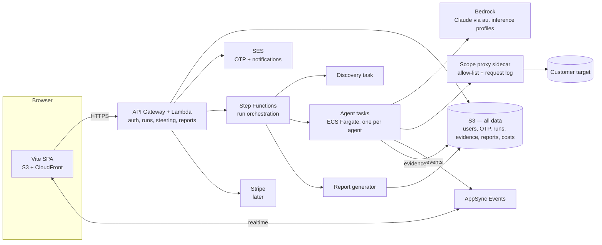

# Swarm — Self-Serve Product Plan

Turn the *simulated* swarm on [fhlostonadvisory.com](https://fhlostonadvisory.com/) into a real, self-serve product, **Swarm**, at its own dedicated domain, `fhlostonswarm.com` (registered in the swarm AWS account): a customer signs in, points the swarm at their application, watches the agents work in real time, steers them, and receives a report like [example-report.html](./example-report.html).

> Status: **draft, all decisions made** (see [section 16](#16-decisions-log)); remaining actions and numbers to tune are in [section 17](#17-launch-checklist--items-still-to-tune). The phased build and verification plan is in [IMPLEMENTATION.md](./IMPLEMENTATION.md).

## 1. What we are building

| Area | Summary |
|------|---------|
| **Web app** (Vite) | OTP email login → intake form → live "swarm" view → steering → report download; account/data deletion |
| **Staff dashboard** | `@fhlostonadvisory.com` logins only: per-run cost analysis, usage, support tools |
| **Backend** (AWS, `ap-southeast-2`, account `885922397779`) | Auth, run orchestration, sandboxed agent execution on Bedrock, event streaming, report generation. **All data in S3.** |
| **Agent runtime** | Driven by the baseline methodology in [instructions/](./instructions/README.md), adapted per target by a discovery phase |
| **Entitlements / payments** | 1 free **lite** report per customer; paid full reports and (later) scheduled runs via Stripe |

**Branding:** Swarm has its own brand and does not reuse the Fhloston Advisory look. The marketing-site simulation is a functional reference only. Fhloston appears as "a Fhloston Advisory product" in the footer/ToS. Starting direction (to iterate on): **modern, exciting, AI/tech theme** — dark UI, neon/electric accents with soft glow, glassy panels, monospace/terminal touches, generative "swarm" motion. M1 ships a placeholder identity (wordmark + palette + design tokens in one theme file) so it's cheap to change later.

### What the marketing-site simulation tells us (reviewed from its JS bundle)

The site is a client-rendered SPA, so the simulation lives in its bundle. Key facts to reuse:

- **5 areas:** Recon (DNS/WHOIS/CT) · OWASP Top 10 & TLS · AuthN/AuthZ & API · LLM Top 10 · Logic/IDOR/privesc — these map 1:1 to phases 1–5 in [instructions/](./instructions/README.md).
- **12 agents:** `dns`, `surface`, `bundle` (recon); `tls`, `zap`, `cors` (unauth); `authn`, `session`, `authz` (authn); `prompt`, `output` (llm); `idor` (logic). Each has a colour, a "face" (visor / round / cyclops / hex / ears) and a list of steps.
- **Event model:** `dispatch → start(step) → finish(step: clear | info | finding | gap) → verify(finding) → agent-done → complete`. Findings are *candidates* until an independent agent cross-checks them. `gap` = something we could not test (reported as a scope limitation).
- **UI state:** per-agent status/current task/tag/progress, per-area progress bars, a findings list with severity + verified flag, an event log, and a "checks completed" counter.

**Key design move:** make this event schema the **contract** between backend and UI. Build the UI first against a *replay of the simulated feed* (same schema), then swap in the real event stream with no UI changes. It also gives us a demo/replay mode for free.

## 2. Architecture overview



**Principles**

1. **Per-run isolation.** Every run gets its own S3 prefix and ephemeral Fargate tasks. Nothing is shared across customers.
2. **Agents are untrusted by design.** The target is hostile (prompt injection via page content is expected). Agents have a tool allow-list, no AWS permissions beyond writing their own run's events/evidence, and egress only through a scope-enforcing proxy.
3. **Scope is enforced by the platform.** Agents can only reach the hosts the customer declared (see [section 6](#6-scope-enforcement--abuse-prevention)). Target ownership verification is deferred for now but designed in.
4. **Events are the source of truth.** The UI, the report and scheduled-run diffs are all derived from an append-only run event log.
5. **Everything in IaC** (AWS CDK, TypeScript) and deployable within the one swarm account (a single environment; any future dev/stage would be a separate account).
6. **Zero idle cost.** With no scans running, the only things that exist are S3 data, serverless request-driven services (CloudFront, API Gateway, Lambda, AppSync Events, Step Functions, SES) and a few small fixed items (Route 53 zone, logs). No always-on compute, no NAT gateway, no interface VPC endpoints, no WAF at launch, no provisioned capacity. Details and an estimate in [section 14](#idle-cost-at-rest).

## 3. Repository layout

`src/` is reserved for the application (per repo conventions); `utils/` + `swarm.ts` remain the ops CLI. Use npm workspaces:

```
src/
  web/        Vite + React + TS SPA
  api/        Lambda handlers (auth, runs, steering, reports, billing)
  agents/     Agent runtime (container image), tool implementations, prompts loader
  infra/      AWS CDK app (stacks: edge, auth, data, runs, agents, reports, billing)
  shared/     Types: run events, findings schema, API contracts (zod)
instructions/ Baseline methodology (existing) — versioned + bundled as agent prompt templates
utils/        Existing CLI (swarm login, later: swarm deploy / swarm run-local)
```

## 4. Web app (Vite)

**Stack:** Vite + React + TypeScript, TanStack Query for API state, Zustand (or similar) for the live run store, Zod for shared contracts. Hosted on S3 + CloudFront at **`fhlostonswarm.com`** (API under the same host, e.g. `/api/*`, so cookies stay first-party).

### Screens

1. **Login** — email → 6-digit code → session. Shows "1 free lite report" status after login.
2. **Dashboard** — past runs, status, report links, remaining credits, "New assessment", per-run **Delete** action.
3. **New assessment (intake)**
   - Application URL (required) and marketing/landing page URL (optional). Their hostnames become the run's allowed scope.
   - Tier shown up front: **Lite** (free demo: one login, limited read-only exploration, cheap model, teaser report) or **Full** (paid, later) with what each includes ([section 11](#11-entitlements-lite-tier--payments)). Lite uses one login (the customer picks which, default `user1`); the other slots show an "available in Full" hint.
   - **Test logins** — four fixed slots with a free-text *description of permissions* each:

     | Slot | Typical meaning | Maps to tier in [instructions/README.md](./instructions/README.md#4-login-access-levels) |
     |------|-----------------|------|
     | `admin` | Full administrative access | Admin |
     | `user1` | Normal user | Standard |
     | `user2` | Second normal user *(enables horizontal-escalation tests)* | Standard (2nd) |
     | `other` | Different permissions (read-only, manager, support…) | Read-only / Elevated |

     Each slot: username, password, description, optional notes (MFA, login URL, quirks). The form says clearly: use staging/test credentials, never production. UI nudges ≥3 logins and explains why; fewer is allowed (reduced coverage is recorded as a `gap`).
   - Optional: scope notes ("don't touch /billing"), known-safe test data, rate-limit preference, staging-vs-prod warning.
   - Authorization acknowledgement (checkbox + timestamp + IP stored): "I am authorised to test these systems."
4. **Live swarm view** (the hero)
   - Futuristic canvas: agents render as glowing faces swarming around the target "core", with beams/pulses when an agent probes an endpoint, colour-coded by area (reuse the site's 12-agent palette/faces).
   - Side panels: per-area progress, live findings (severity + verified badge), event log, checks counter, token/cost-budget meter.
   - Tech: PixiJS (WebGL) or plain Canvas 2D for the swarm; React for panels. Respect `prefers-reduced-motion` and provide a low-power mode.
   - Click an agent → its current task, recent steps, and a "steer this agent" box.
5. **Steering panel** — see [section 9](#9-steering-the-agents).
6. **Report** — in-app HTML view, download HTML / PDF / JSON (and SARIF later).
7. **Schedules** *(roughed in, disabled)* — shows "Continuous monitoring — coming soon" and captures interest.
8. **Account / data** — delete an individual run (and its report/evidence), or **delete account** (removes everything, see [section 14](#14-security-privacy--operations)).
9. **Staff dashboard** (`/staff`, only visible to `@fhlostonadvisory.com` logins) — see [section 12](#12-staff-support-dashboard--cost-tracking).

### Realtime transport

Use a managed pub/sub rather than hand-rolling WebSockets: **AppSync Events** (one channel per run: `/runs/{runId}`), with the browser authorized via a short-lived token minted by the API. Fallback if we don't want AppSync: SSE from a Lambda function URL with response streaming (no connection table needed). AppSync Events is transport only, not storage. On reconnect the UI first loads the event log from S3 then resumes the live stream (event `seq` numbers make this idempotent).

## 5. Auth: email OTP via SES

### Recommendation on email delivery: **SES, not Google Workspace SMTP**

- Workspace SMTP/relay has per-user/day caps, is tied to a human mailbox/app password, and is poor for deliverability monitoring/bounce handling. SES is built for transactional mail, has bounce/complaint events, and fits the AWS stack.
- **SES and Google Workspace coexist fine.** `fhlostonadvisory.com` is untouched (its MX stays on Google; humans' mail, including `support@`, is unaffected). We create the SES identity on the dedicated **`fhlostonswarm.com`** domain, so Swarm mail has its own reputation/branding, and its DNS is in our own Route 53 zone in the swarm account (see DNS below).

### SES setup (ap-southeast-2) — one-time

1. Create a **domain identity** for `fhlostonswarm.com` with **Easy DKIM** (3 CNAMEs).
2. Configure a **custom MAIL FROM** subdomain (e.g. `bounce.fhlostonswarm.com`: MX → `feedback-smtp.ap-southeast-2.amazonses.com`, TXT SPF `v=spf1 include:amazonses.com ~all`) for DMARC alignment.
3. Publish/verify **DMARC** (`_dmarc.fhlostonswarm.com` TXT) — start `p=none` with `rua` reporting, move to `quarantine` once clean.
4. **Request production access** (out of the SES sandbox) — do this early; it takes ~1 day. Describe: OTP + transactional only, bounce/complaint handling, opt-in only.
5. Create a **configuration set** with event destinations (bounce/complaint/delivery → SNS → Lambda that writes a suppression list object to S3, `suppression/{emailHash}.json`).
6. Send from `login@fhlostonswarm.com`; set `Reply-To: support@fhlostonadvisory.com` (stays in Google Workspace).

### DNS (decided: dedicated domain `fhlostonswarm.com` in the swarm account)

Swarm gets its own domain, **`fhlostonswarm.com`**, registered in the swarm AWS account (885922397779), so everything (registration, DNS, certificates, CloudFront, SES) lives in one account. A Route 53 public hosted zone for it already exists in that account, and it is the authoritative zone (the domain's name servers must point at it). `fhlostonadvisory.com` and its other AWS account are not involved, so there is **no cross-account step and no manual DNS work**.

CDK looks up the existing hosted zone (`HostedZone.fromLookup`, not create) and manages all records in it: apex alias → CloudFront (A/AAAA), ACM certificate validation, SES DKIM, MAIL FROM, DMARC and any future records. The only fixed DNS items are the hosted zone and the domain registration/renewal (enable auto-renew).

### OTP flow

1. `POST /auth/request {email}` — normalize email, always respond identically (no user enumeration), rate-limit per email + IP, send a 6-digit code (also include a magic link `fhlostonswarm.com/auth/verify?token=…`).
2. Code: CSPRNG, stored **hashed** (HMAC) with 10-minute expiry, max 5 attempts, single use. (Storage: S3, see below.)
3. `POST /auth/verify {email, code}` → issue a session: signed JWT (`jose`) in an `HttpOnly; Secure; SameSite=Lax` cookie, short-lived (e.g. 12h) with refresh via a rotating refresh token stored server-side (revocable → fixes the "no server-side logout" finding we routinely report on others).
4. CSRF protection for cookie-authenticated mutating calls (double-submit token or `SameSite=Strict` + origin check).
5. Turnstile/hCaptcha on `auth/request` to protect SES reputation (optional but recommended).

### Auth approach (decided): custom OTP + `jose` JWT

A small custom OTP module plus `jose` JWTs, framework-agnostic (Hono on Lambda). Passport.js was considered but adds little here (OTP logic is ~150 lines, API runs on Lambda); Cognito was rejected (clunky, and doesn't fit the S3-only user store). A Passport strategy could be added later if social login is wanted.

### Where data lives: S3 only (decided)

Everything lives in one S3 bucket (`swarm-data-885922397779`), default encryption (SSE-S3), block public access, versioning **off** (so deletes really delete). No DynamoDB. The atomic operations we need are covered by S3 **conditional writes**: `If-None-Match: *` (create only if absent) and `If-Match: <etag>` (compare-and-swap update).

```
users/{emailHash}/profile.json              user profile (plain email, created, role: customer|staff, free-claim state)
users/{emailHash}/runs/{runId}/input.json   target URLs, scope, logins, tier, ToS ack
users/{emailHash}/runs/{runId}/events/...   append-only event chunks (seq-numbered objects)
users/{emailHash}/runs/{runId}/evidence/... HAR, screenshots, tool output
users/{emailHash}/runs/{runId}/report/...   report.html, report.pdf, findings.json
users/{emailHash}/runs/{runId}/cost.json    token/compute usage + estimated cost (see section 12)
users/{emailHash}/sessions/{sessionId}.json refresh tokens (revocable)
auth/otp/{emailHash}.json                   current OTP challenge (hashed code, expiresAt, attempts)
auth/ratelimit/{emailHash|ipHash}/{window}.json  coarse counters
claims/free/{emailHash}.json                free-report claim marker (see section 11)
claims/free-target/{domainHash}.json        one Lite run per target domain (30-day cool-off)
suppression/{emailHash}.json                SES bounce/complaint suppression
admin/run-index/{yyyy}/{mm}/{dd}/{runId}.json   anonymised per-run summary + cost for the staff dashboard
```

How each requirement maps onto S3:

| Need | Approach |
|------|----------|
| OTP single use, max 5 attempts | `auth/otp/{emailHash}.json` updated with `If-Match` (compare-and-swap) on each attempt; delete on success. Expiry is enforced in code via `expiresAt`; an S3 lifecycle rule (1-day minimum) is the backstop cleanup. |
| Rate limiting | Coarse per-email/IP window counters via the same compare-and-swap, **plus** API Gateway throttling and Turnstile/hCaptcha on the auth endpoints (S3 is the wrong tool for per-request limiting). A WAF with rate-based rules is an optional add-on if abuse appears (see [section 14](#idle-cost-at-rest)). |
| Free report claimed once | `claims/free/{emailHash}.json` created with `If-None-Match: *`; a second concurrent claim gets `412` and is refused. |
| Listing a user's runs | `LIST users/{emailHash}/runs/` — cheap at this scale; the dashboard reads each run's small `summary.json`. |
| Staff cost view | Per-run summary written to `admin/run-index/...` (anonymised), plus daily rollups. Athena over the bucket is a later option if volume grows. |
| Account deletion | Everything per-user sits under `users/{emailHash}/`, so deletion is one prefix delete (see [section 14](#14-security-privacy--operations)). |

Trade-offs accepted by going S3-only: no TTL (handled in code + lifecycle), no atomic counters (compare-and-swap with retry), no secondary indexes (prefix layout + index objects). All fine at this scale; revisit if run volume or auth traffic grows large.

- **Key:** `emailHash = HMAC-SHA256(pepper, normalizedEmail)` (pepper in an SSM Parameter Store SecureString — standard tier is free, unlike Secrets Manager's per-secret monthly fee). Normalize: trim, lowercase, strip `+tag`, and for Gmail/Google-hosted domains collapse dots — otherwise the free report is trivially farmed. Block known disposable-email domains.
- Store the plain email only in `profile.json` (needed to send mail).
- **Staff role:** derived at login — after a successful OTP, if the normalized email's domain is exactly `fhlostonadvisory.com` the session gets `role: staff`. OTP proves mailbox control, so only people who can read `@fhlostonadvisory.com` mail (Google Workspace) can get it. Exact domain match only (no subdomains, no look-alikes).

### Incoming email / support

Inbound email stays in **Google Workspace** for now (`support@fhlostonadvisory.com` as a group/mailbox for humans). Swarm only sends mail (OTP, "report ready"), with `Reply-To: support@…`. No SES inbound, no ticketing integration yet.

## 6. Scope enforcement & abuse prevention

A self-serve tool that attacks customer-supplied URLs can be misused. **Decision: no target ownership verification for now** — customers declare the targets and tick an authorisation acknowledgement. Because that removes the strongest control, the remaining ones matter more:

1. **Scope enforcement in the platform, not just the prompt:** all agent traffic goes through an egress proxy that only permits the hostnames the customer declared (application URL + optional marketing URL, plus any explicitly listed API hosts). It also gives us full request logging (evidence + audit trail). Out-of-scope hosts discovered during recon are *noted, not touched* (as the site's simulation already does).
2. **Non-destructive, rate-limited by default:** per-run requests-per-second cap, no DoS/high-volume fuzzing tools, agents told to avoid delete/payment/email-sending actions and the tool layer blocks the obvious ones.
3. **Terms + authorization acknowledgement** stored with timestamp/IP/email (in `input.json`). Customer confirms they are authorised to test and accept impact; the form recommends staging and says never to use production credentials.
4. **Abuse controls:** per-user/day run caps, global concurrency cap, block lists (gov/critical-infra, our own domains, other well-known third-party SaaS/CDN hosts, cloud metadata IPs), RFC1918/link-local/IMDS blocked at the proxy (stops SSRF *from* our runners), kill switch (global + per-run, available in the staff dashboard), customers can press **Stop** at any time.
5. **Lite free tier limits blast radius:** free runs are passive plus a **limited, read-only authenticated exploration** (login, then GET-only navigation; the proxy blocks every other state-changing request) with hard time/request/spend caps (see [section 11](#11-entitlements-lite-tier--payments)), and only for email-verified accounts.
6. **Simple identification, no fixed egress IPs:** requests carry `User-Agent: Swarm/<version> (+https://fhlostonswarm.com/about)`. Customers start the scan themselves against their own staging site, so recognising or allow-listing our traffic isn't our concern, and we don't need fixed egress IPs (which would require an always-on NAT gateway).
7. **Verification later (designed in, switched off):** the `input.json` schema reserves `targetVerification: { method: dns|file|meta, verifiedAt }`, and the proxy takes its host list from a single allow-list function, so adding "prove you own it" (DNS TXT / `/.well-known` file / meta tag) before active testing is a small change. Recommended before heavy public launch or any paid active/authenticated testing at scale.

## 7. Backend: running the agents on AWS

### Run lifecycle (Step Functions state machine)

1. **Create run** — validate input, check entitlement (free lite claim or paid credit), snapshot inputs (including test credentials, see below) and resolve the tier's agent set and budgets.
2. **Phase 0 — Discovery** (new, dynamic): one agent fingerprints the target and produces the **engagement plan** (see [section 8](#8-dynamic-instructions--discovery-phase)).
3. **Fan-out** — launch the planned agents as parallel **ECS Fargate tasks** (Map state), grouped by methodology phase. Phases that depend on earlier output (authenticated testing needs login validation, business logic needs the authz map) run after their prerequisites.
4. **Verification** — for each candidate finding, an *independent* verifier agent reproduces it and attaches evidence; unverifiable candidates are downgraded/marked "unconfirmed" (matches the site's "cross-checked by independent agents" step).
5. **Report assembly** — merge findings, de-duplicate across phases, render outputs.
6. **Notify** — SES email "your report is ready"; update run status; expire resources.

Why Fargate (not Lambda): browser automation (Playwright), ZAP/nuclei/testssl-style tooling and long LLM tool loops exceed Lambda's 15-minute limit and need a real filesystem/binaries. Alternatives to evaluate: **Bedrock AgentCore Runtime** (managed agent hosting/isolation) once its fit and regional availability are confirmed.

### Agent runtime

- **Container image** with: Node/TS agent loop, Playwright + Chromium, a curated set of CLI tools (ZAP baseline, testssl, nuclei, dig/whois, subfinder-style CT lookups). Tools are exposed to the model as typed functions — the model never gets a raw shell on a shared box.
- **Models (decided):** Claude via **Amazon Bedrock** in `ap-southeast-2`, using the **`au.` (Australia) cross-region inference profiles** so inference stays in Australian regions (avoid `global.` profiles; useful for the privacy story). **No Opus-class models** — they add cost without meaningful benefit for this work. Sonnet-class is the workhorse for Full runs (exploration, exploitation reasoning, verification, report writing); Haiku-class for Lite runs and high-volume/simple steps (recon, summarising tool output). Profiles seen `ACTIVE` in the swarm account (checked with `aws bedrock list-inference-profiles`):

  | Role | Initial default | Newer options also listed |
  |------|-----------------|---------------------------|
  | Full / workhorse | `au.anthropic.claude-sonnet-4-6` | `au.anthropic.claude-sonnet-5`, `au.anthropic.claude-sonnet-5-5` |
  | Lite / simple steps | `au.anthropic.claude-haiku-4-5-20251001-v1:0` | `au.anthropic.claude-haiku-5-5` |

  Initial defaults are conservative choices; the newer Sonnet/Haiku generations will be benchmarked (quality vs cost) on the synthetic vulnerable target in M4/M5 before switching. Model IDs live in tier config, so switching is a config change, and the price table in [section 12](#12-staff-support-dashboard--cost-tracking) is keyed by model. **Invocation is not yet usable:** a test call was rejected because the AWS account is still being verified (see [section 17](#17-launch-checklist--items-still-to-tune)).
- **Framework:** Strands Agents SDK (TS/Python) or a thin custom loop over the Bedrock Converse API. Start with a thin loop (we control tool-calling, budgets and event emission); revisit.
- **Budgets per agent/run:** max steps, max tokens, wall-clock timeout, max requests, set per tier (lite < full). Hitting a budget emits a `gap`, not a silent stop.
- **Usage metering:** every Bedrock Converse call returns token usage; every agent task records start/stop and vCPU/memory size. The agent runtime writes these to the run's `cost.json` (see [section 12](#12-staff-support-dashboard--cost-tracking)).
- **Isolation:** one task per agent per run, no inbound (security group denies all ingress), tasks destroyed after run. To avoid an always-on NAT gateway and interface VPC endpoints, tasks run in **public subnets with a public IP** (internet access via the free internet gateway; S3 via a free gateway endpoint) and a **scope-proxy sidecar container in every task** enforces the host allow-list, blocks private/link-local/metadata addresses (including the ECS task metadata endpoint) and logs requests; the agent container can only reach the network through the sidecar (task-local networking + egress security-group rules). Task role scoped to `users/{emailHash}/runs/{runId}/*` and event publish for that run, read-only root FS where possible.
- **Prompt-injection hardening of our own agents:** treat all target content as untrusted data, wrap tool output in delimiters, no tool that can reach other runs/customers, never let model output choose the host (scope proxy decides), and output validated against schemas before it becomes an event/finding.

### Customer test credentials (keep it simple)

We tell customers to supply **staging/test credentials, never production** (stated on the intake form and in the ToS), so these are treated as low-sensitivity test data, not secrets.

- Stored in the run's input file in S3 (`users/{emailHash}/runs/{runId}/input.json`) with default S3 encryption (SSE-S3), like the rest of the run data. No KMS, no Secrets Manager.
- Agents read them directly from the run input and can use them as needed (login, fill forms, API auth). No special `login(role)` injection layer.
- Basic hygiene only: don't print passwords in the customer-facing report or public log lines. They are removed when the customer deletes the run or account.
- Scheduled runs (later) reuse the credentials stored with the target; the customer can update or remove them at any time.

### Event streaming & storage

- Each agent emits events (`seq`, `ts`, `runId`, `agent`, `type`, payload) to an API that (a) writes seq-numbered chunk objects under `users/{emailHash}/runs/{runId}/events/` in S3 (S3 can't append, so small batched objects, merged into one `events.jsonl` when the run completes), (b) updates the run's `summary.json` (status, counts, tier, timestamps), (c) publishes to the AppSync channel.
- Evidence (HAR, screenshots, tool output) → `users/{emailHash}/runs/{runId}/evidence/{phase}/…` mirroring the layout in [phase-6-reporting.md](./instructions/phase-6-reporting.md); customer-visible versions are redacted. Agent task roles are scoped to their own run prefix.

## 8. Dynamic instructions & discovery phase

The existing [instructions/](./instructions/README.md) are a **baseline playbook**, written for a human-plus-AI engagement (fixed engagement under `2026/assessment1`, "Instructions for Human Tester", manual sign-off). To run unattended and adapt per target:

1. **Productise the baseline.** Convert each `phase-N-*.md` into a versioned **prompt module** with explicit sections: *objective, guardrails (immutable), checks, tools, evidence format, output schema*. Store in S3 (versioned) / bundled in the agent image; record the `instructionsVersion` on each run for reproducibility.
2. **Discovery (Phase 0):** a planner agent crawls the app (unauthenticated, then with each login provided for the tier; Lite uses 1 login and a page cap) and classifies it: SPA/server-rendered, API style (REST/GraphQL), auth mechanism (session cookie / JWT / OAuth), tech stack, presence of AI/LLM features, file uploads, payments, multi-tenancy, roles. In Lite this discovery output **is** the "what we understood about your application" section.
3. **Engagement plan:** the planner emits `engagement.json` (schema-validated): which agents to run, which checks to enable/skip (e.g., skip Phase 4 if no LLM features — recorded as "not applicable" in the report), role-specific test matrices from the customer's login descriptions, target-specific hints (routes, API base URLs), and estimated budget.
4. **Constraints on adaptation:** the planner can add/remove/reorder checks but **cannot** remove guardrails, widen scope, or change the allowed-tool list. Plan is shown to the customer (and editable by steering) before/while it executes.
5. **Replace human sign-off points** with: automated verifier agent + explicit "unverified" label. Reports are **automated only** for now (no analyst review step); the report says so.
6. Update the instruction files to remove engagement-specific content (target URL, credentials, 2026 paths) — `tasks.md` becomes a *generated* artefact per run rather than a hand-edited file.

## 9. Steering the agents

The customer talks to the swarm through a **steering inbox** (per run, per optional agent):

| Customer intent | Example | Effect |
|-----------------|-----------|--------|
| **Deep dive** | "Look harder at F-03 / the file upload" | Orchestrator spawns/redirects an agent with the finding's context and extra budget |
| **Accept risk** | "We accept the risk on F-05" | Finding status → *Accepted by customer* (kept in report, separated, excluded from future-run alerts); requires note, audit-logged |
| **Scope narrowing** | "Don't test /billing", "skip LLM tests" | Added to engagement plan + enforced in the proxy where it's a path/host rule |
| **Context** | "Role `other` is a support agent who can view all tickets" | Added to the role matrix |
| **Pause / stop** | Stop button | Run state machine cancels tasks, still produces a partial report |

Mechanics: messages go to `POST /runs/{id}/steer` → stored as events → an **orchestrator/steering agent** interprets free text into a structured *directive* (zod-validated) → agents read their inbox **between steps** (not mid-tool-call). Steering **can never widen scope** beyond the declared hosts or lift guardrails; ambiguous/invalid requests are answered in the chat with a clarification. Everything is logged and appears in the report's methodology section.

## 10. Report output

- Source of truth: `findings.json` (schema: id, title, severity, CVSS/OWASP/LLM-Top-10 mapping, affected component, description, evidence refs, reproduction steps, remediation, status [open/accepted/unverified], verified flag, agent, phase).
- Renderer: HTML template reproducing [example-report.html](./example-report.html) sections: 1 Executive Summary · 2 Positive Findings · 3 Scope & Methodology · 4 Testing Performed (per phase) · 5 AI/LLM Testing · 6 Technical Findings · 7 Static Code Analysis (n/a unless source supplied) · 8 Informational · 9 Recommended Priorities. Plus **Scope limitations / gaps** (from `gap` events and missing logins).
- Exports: self-contained HTML, **PDF** (headless Chromium in the report task), JSON; SARIF/CSV later.
- LLM writes prose (exec summary, remediation) **from validated findings only**; numbers (counts by severity) are computed, not generated.
- Redaction pass: test passwords, tokens, cookies, PII and verbatim jailbreak output are scrubbed from customer-facing output (per [phase-6-reporting.md](./instructions/phase-6-reporting.md)); raw evidence stays in the private run prefix.
- **Lite gating is enforced server-side**, not in the UI: for Lite runs the API only ever serves `findings.teaser.json` (top N in detail, rest title/severity only) and the live event stream carries the same reduced payload for locked findings. Full details are stored separately and are not downloadable until the run is upgraded/purchased.
- Delivery: presigned S3 URLs behind an authenticated API call. Reports are kept until the customer deletes the run or their account (no automatic expiry yet).
- Clear disclaimer: **automated**, AI-assisted assessment (no human review); not a certification or a substitute for a full manual penetration test (positioning vs. the human Fhloston Advisory engagement). Lite reports are teasers (severity counts, top findings only) and list the areas not covered.

## 11. Entitlements, lite tier & payments

- Model every run as consuming an **entitlement**: `free_lite_report` | `paid_report` | `subscription_run`. The ledger is S3 objects under the user prefix (`users/{emailHash}/entitlements.json`, compare-and-swap updates); the free claim is the `claims/free/{emailHash}.json` marker ([section 5](#where-data-lives-s3-only-decided)). Stripe plugs in later.
- **Free report = Lite: a cheap but real demo (decided).** Purpose: let a customer *see the swarm work* and show the core differentiator — **the swarm understands the customer's actual application and content**, it isn't just an OWASP Top 10 scanner. Many web apps are little more than a login page, so Lite **does log in and poke around**, but with tightly limited exploration. Design goals: a Lite run is **worth little to someone farming free accounts** (temp emails) and **costs cents to low dollars**. Tier config is data, not code. Initial values are set below and are tunable:

  | | Lite (free demo) | Full (paid) |
  |---|---|---|
  | Checks | Passive checks (DNS/CT, security headers, TLS, CORS, robots/sitemap, quick JS-bundle scan) **plus** a short, read-only authenticated exploration | All 5 areas incl. LLM Top 10 and logic/IDOR/privesc, with real testing and verification |
  | Logins | **Kept**: **1 login** (customer's choice, defaults to `user1`; a second can be enabled in config). Remaining slots shown as "available in Full" | All 4 slots |
  | Exploration | **Limited and read-only:** log in, then navigate/GET only, within the page/step caps below. The proxy blocks any state-changing request other than the login itself. Goal: understand what the app is and does, not attack it | Deep, role-by-role, authorisation and logic testing |
  | Agents | A small set: passive ones (`dns`, `surface`, `tls`, `cors`, `bundle`) + an **explorer** agent (login, map pages/roles/features) | All 12 + verifier |
  | Model | **Cheap model (Haiku-class)** so the content understanding is real but inexpensive | Sonnet-class (see [section 7](#agent-runtime)) |
  | Steering | None (watch only) | Unlimited |
  | Limits | Hard caps (initial values below); the run is stopped when any is reached | Larger caps (initial values below) |
  | Report | **Teaser report** (see below) | Full report |
  | Swarm view | Full live animation (this is the demo) | Same |

  **Teaser report:** includes a full **"What we understood about your application"** section (app purpose, main areas/features, the roles observed per login, key flows) — this is the differentiator and is shown in full. Findings: severity counts plus full detail for only the top N (initially **2**); remaining findings shown as title/severity with details locked behind the paid report. Uncovered areas are listed as "not included in Lite".

  The gating is deliberate: even if someone farms free runs, they don't get the full vulnerability list, so there is little reason to do it.

  **Initial tier config (best-judgement starting values — all tunable from real `cost.json` data, see [section 12](#12-staff-support-dashboard--cost-tracking)):**

  | Setting | Lite | Full |
  |---------|------|------|
  | Model | Haiku-class | Sonnet-class (Haiku-class for simple steps) |
  | Logins used | 1 | up to 4 |
  | Wall-clock cap | 6 min | 60 min |
  | Page / step cap (explorer) | 25 pages, 40 LLM steps | no fixed page cap; per-agent step budgets |
  | Request cap / rate | 150 requests, ≤2 req/s | 3,000 requests, ≤5 req/s |
  | Token cap | ~400k input / 20k output total | per-agent budgets (set after M4 measurements) |
  | Hard spend cap per run | **≈ US$0.50** (run stops on reach) | **≈ US$15** (initial; revisit) |
  | Concurrency | 3 Lite runs at once (separate pool) | per-account limit (e.g. 2) |
  | Global daily Lite cap | 50 runs/day and ≈ US$25/day, then "try again tomorrow" | n/a |
  | Per-target-domain cool-off | 30 days | n/a |
  | Teaser findings shown in detail | 2 | all |
  | Steering | none | unlimited |

  Dollar caps are estimates to be checked against the current Bedrock price list once invocation works; token and spend caps are enforced from the metered Converse usage.

- **Stripe Checkout** (one-off per full report) → webhook → credit. Stripe Tax for AU GST. Customer portal for invoices. Subscription + metered usage for scheduled runs.
- **Pricing: TBD.** Prices will be set from measured cost per run (see [section 12](#12-staff-support-dashboard--cost-tracking)): `price ≈ measured_cost × margin`, plus a floor. Placeholders to fill in later: Full report **$TBD**, scheduled run **$TBD/run** (the Lite spend ceiling already has an initial value in the tier config above).
- **Free-tier abuse controls** (temp-email farming):
  - One Lite run per normalized email (atomic claim, see [section 5](#where-data-lives-s3-only-decided)) and **one Lite run per target registrable domain** (`claims/free-target/{domainHash}.json`, created with `If-None-Match: *`, 30-day cool-off), so new emails can't re-scan the same site.
  - Disposable/temporary-email domain blocking (maintained list) and no `+tag`/dot aliasing.
  - Per-email/IP counters, API Gateway throttling and Turnstile/hCaptcha on signup (`/auth/request`) and on starting a Lite run (add WAF IP/ASN rate rules later if needed).
  - **Global daily cap on Lite runs** (initially 50/day and ≈ US$25/day) and a daily Lite spend budget. When hit, new Lite requests are declined with "try again tomorrow" rather than spending more. Alarm when Lite volume spikes.
  - Lite spend and run counts, per day, are on the staff dashboard ([section 12](#12-staff-support-dashboard--cost-tracking)) with the caps editable there.
  - Lite runs use the cheap model and smallest compute settings and a separate low concurrency limit so they can never starve paid runs.

## 12. Staff support dashboard & cost tracking

A `/staff` area in the same app, only for sessions with `role: staff` (derived from an `@fhlostonadvisory.com` email at login, see [section 5](#where-data-lives-s3-only-decided)). Staff API routes re-check the role server-side on every call; the SPA hiding the menu is not the control. Staff views never show customer test passwords by default.

**Per-run cost capture** (written by the agent runtime and orchestrator to `cost.json`, copied anonymised to `admin/run-index/…`):

| Cost component | Captured from | Notes |
|----------------|---------------|-------|
| Bedrock tokens | Converse `usage` per call: input, output, cache read/write tokens, per model, per agent | Dominant cost expected |
| Fargate compute | Task start/stop × vCPU/GB, per agent | |
| Egress data | Bytes via the proxy (public internet data transfer out) | Likely small |
| S3, AppSync, SES, Step Functions | Object/event/email counts | Likely negligible; estimated |
| **Estimated total** | Computed from a **price table** in config (`pricing.json`, values **TBD**/to be verified against current AWS prices) | Table versioned so old runs keep the prices used |

Optionally reconcile estimates against Cost Explorer using a `run` / `tier` cost-allocation tag on tasks.

**Dashboard views:**

1. **Runs** — table (time, tier, entitlement type, status, duration, findings count, estimated cost); filter by date/tier/status/free vs paid.
2. **Run detail** — cost breakdown by agent and model, token counts, steps, budget used vs cap, gaps/budget-exhausted agents, event log, link to report. Useful for tuning budgets and diagnosing bad runs.
3. **Cost analysis** — avg/median/p95 cost per run by tier; total spend by day; cost of free vs paid runs (free-report acquisition cost); cost per finding; most expensive agents. Includes a **pricing worksheet**: input a margin → suggested price, vs the **TBD** placeholders.
4. **Users / support** — look up a user by email (hash computed server-side), see their runs and status, resend a report-ready email, stop a running job, and delete a user's run or account on request (audit-logged).
5. **Controls** — global kill switch, daily Lite-run and Lite-spend caps, concurrency caps, tier budget caps (edit the tier config), block list of hosts and email domains.
6. **Health** — SES bounce/complaint rate, stuck runs, Bedrock throttling.

**Anonymised cost history survives deletion:** when a customer deletes a run/account, `users/{emailHash}/…` is removed, but the anonymised `admin/run-index` record (tier, timings, token counts, cost, no email/hash/target/findings) is kept for cost analysis. This is stated in the privacy notice.

## 13. Scheduled runs & notifications (rough-in only)

- Data model: `schedule { cron, targetId, notifyOn: new|any|none, channels }` on the target; **EventBridge Scheduler** → same state machine with `trigger: scheduled`.
- Diff engine: compare findings by stable fingerprint across runs → *new / fixed / regressed / accepted*. Alert only on *new* (and not accepted) findings via SES, with webhook/Slack later.
- Paid per run (price **TBD**); reuses the credentials stored with the target. Ownership re-verification is added if/when target verification is switched on.
- Ship now: schedule fields in the schema, a disabled "Schedules" tab, and the diff-friendly finding fingerprint. Build later.

## 14. Security, privacy & operations

- **Our own security:** the product still holds customers' vulnerability data (and staging test creds). Run our swarm against ourselves before launch; CloudFront's built-in DDoS protection plus API Gateway throttling at launch (**AWS WAF is optional** — a web ACL costs ~US$5–10/month even when idle, so add it only if abuse shows up; if added, use a single ACL on CloudFront in front of both the SPA and `/api/*`), strict CSP/HSTS (the findings we report on others), least-privilege IAM, CloudTrail management events (first trail is free; no S3 data-event logging), GuardDuty (usage-based, optional). The staff role is derived from verified email only and re-checked server-side.
- **Data deletion (decided, instead of a retention policy for now):**
  - **Delete a run** (Dashboard → Delete): cancels it if running, then deletes `users/{emailHash}/runs/{runId}/` (input incl. logins, events, evidence, reports, cost). Confirmation required; irreversible.
  - **Delete account** (Account → Delete account): cancels in-flight runs, then deletes everything under `users/{emailHash}/` (profile, sessions, runs, entitlements), `auth/otp/{emailHash}.json` and the user's rate-limit counters, revokes all sessions, and emails a confirmation. Requires a fresh OTP re-confirmation.
  - Because versioning is off, deletes are permanent; CloudTrail data events/logs must not store customer content.
  - **Retained after account deletion (called out in the privacy notice):** (a) the `claims/free/{emailHash}.json` marker — an irreversible HMAC hash with no personal data, kept only so deleting and re-registering can't mint another free report (accepted, see [section 16](#16-decisions-log)); (b) anonymised cost records ([section 12](#12-staff-support-dashboard--cost-tracking)); (c) future payment records Stripe/tax law require us to keep.
  - A formal retention/lifecycle policy and a full privacy/ToS review are deferred; for now deletion is user-driven.
- **Data handling:** encrypted at rest/in transit (default AWS encryption); documented subprocessors (AWS, Stripe later, Bedrock model provider via AWS — no training on customer data); Australian Privacy Act alignment to be reviewed.
- **Observability:** structured logs (no credentials/customer content), alarms on SES bounce/complaint rate, Bedrock throttling, stuck runs, proxy-blocked egress spikes.
- **Cost guardrails:** AWS Budgets + per-run token/time budgets + global concurrency cap (Bedrock quotas are a real limit) + daily Lite run and spend caps. Runaway protection so nothing keeps billing after a failure: Step Functions state and ECS task timeouts, a "reaper" Lambda on an EventBridge schedule that stops any task/execution older than the max run time, and an alarm on any Fargate task running longer than the tier's wall-clock cap.

### Idle cost (at rest)

Design rule: **if no scan is running, nothing expensive is running.** Verified against the architecture:

| Component | Idle cost | Notes |
|-----------|-----------|-------|
| S3 data bucket | Storage only (cents/GB-month) | Lifecycle rule to abort incomplete multipart uploads; deletes are permanent (versioning off) |
| CloudFront, API Gateway (HTTP API), Lambda | ~0 (per request/ms) | No provisioned concurrency |
| AppSync Events | ~0 (per operation/connection-minute) | Only while someone watches a run |
| Step Functions, EventBridge Scheduler | ~0 (per transition/invocation) | Reaper schedule is a handful of invocations/day |
| SES | ~0 (per email) | **Shared IPs only** — a dedicated IP is ~US$25/month and not needed |
| ECS Fargate | **0** | Tasks exist only during runs; no ECS services, no EC2 |
| Bedrock | **0** | On-demand per-token pricing only; **never provisioned throughput** |
| ECR (agent image) | Cents/month | Lifecycle policy keeps the last few images |
| Route 53 hosted zone (`fhlostonswarm.com`) | ~US$0.50/month | Fixed |
| Domain registration (`fhlostonswarm.com`) | Annual renewal (~US$13/year for `.com`; check Route 53 pricing) | Fixed |
| AWS WAF web ACL | **Not used at launch** (0) | Optional later: ~US$5–10/month fixed for 1 ACL + a few rules |
| CloudWatch Logs | Small | Set retention (e.g. 30 days) on every log group; no custom dashboards/metrics beyond a few alarms |
| SSM Parameter Store | 0 | Standard tier |

**Deliberately avoided (these bill 24/7):** NAT gateways (~US$45/month per AZ), interface VPC endpoints (~US$7/month each per AZ), Secrets Manager secrets, KMS customer-managed keys, RDS/DynamoDB-provisioned/OpenSearch/ElastiCache, always-on ECS/EC2 services, provisioned Lambda concurrency, dedicated SES IPs, Bedrock provisioned throughput.

**Rough steady-state estimate with zero runs: ~US$1–5/month** — essentially the Route 53 zone (US$0.50), a little S3/ECR/log storage and any CloudTrail/GuardDuty extras; if WAF is added later, +US$5–10. To be confirmed with the AWS Pricing Calculator at M0 and watched via AWS Budgets (alert at, say, US$10/month of idle spend).
- **Environments:** a single environment (effectively production) in the swarm account; no `dev`/`prod` stacks or name prefixes. Any future dev/stage system would live in a separate AWS account. Never touches any other AWS account/profile.
- **Testing:** unit tests for OTP/entitlements/scope proxy/redaction/deletion/staff-role checks; contract tests for the event schema; a **synthetic vulnerable target** (deliberately vulnerable app, similar to the site's "synthetic target") for end-to-end agent regression with expected findings. To keep idle cost at zero it is **started on demand** (a Fargate task or container run only during regression/demo runs, or a Lambda/static build), not left running. The marketing-style "demo" in the UI is the replayed event feed, which is static and free.

## 15. Milestones

| # | Milestone | Outcome |
|---|-----------|---------|
| **M0** | Foundations | npm workspaces, CDK skeleton, data bucket, existing `fhlostonswarm.com` Route 53 zone looked up + CloudFront/S3 deploy, SES identity on `fhlostonswarm.com` (DKIM/MAIL FROM/DMARC), **SES production access requested**, Bedrock access re-tested, **log retention + AWS Budgets + idle-cost check (Pricing Calculator) in place** |
| **M1** | UI against simulated feed | Vite app with Swarm branding: swarm visualisation, panels, findings, log — driven by the replay of the marketing-site event schema; shared `RunEvent`/`Finding` types |
| **M2** | Auth | OTP via SES, sessions, S3 user profile, S3 conditional-write OTP/rate-limit/free-claim, staff role |
| **M3** | Intake | New-assessment form (URL, marketing URL, 4 logins + descriptions), ToS ack, "use staging credentials, not production" notice, run delete + account delete |
| **M4** | Walking skeleton backend | Step Functions + one Fargate agent (e.g., headers/TLS) + scope proxy + live events to the real UI + minimal HTML report + **`cost.json` metering** |
| **M5** | Discovery + full swarm | Instruction modules, planner/`engagement.json`, all 12 agents, verifier, authenticated testing with the 4 roles, Lite (teaser report, caps, free-tier abuse controls) / Full tier config, full report + PDF |
| **M6** | Steering | Steering inbox, deep-dive/accept-risk/scope directives, partial-report on stop |
| **M7** | Staff dashboard | `/staff` runs, run detail, cost analysis + pricing worksheet, user lookup, controls |
| **M8** | Hardening & private beta | Self-scan, abuse controls, synthetic-target regression suite, ToS/privacy review, decide on target verification |
| **M9** | Payments | Stripe Checkout, credits, GST, invoices; fill in TBD prices from measured costs |
| **M10** | Scheduled runs | EventBridge, diffing, notifications, subscription billing |

The riskiest unknowns (agent quality/cost, scope enforcement) should be hit by **M4**, so the walking skeleton comes before polish. Cost metering is in M4 so every run from then on contributes to pricing data.

## 16. Decisions log

| Topic | Decision |
|-------|----------|
| Hostname | `fhlostonswarm.com` (dedicated domain, registered in the swarm account) |
| Auth | Custom OTP + `jose` JWT (no Passport) |
| Storage | S3 only, all data in one bucket (conditional writes for atomicity) |
| Free report | **Lite**: cheap-model demo with passive checks, 1 login and limited read-only exploration, teaser report (full "what we understood" section, top findings only), hard time/request/spend caps, one per email and per target domain. Initial numbers in [section 11](#11-entitlements-lite-tier--payments) |
| Target verification | Not required for now (hooks reserved; see [section 6](#6-scope-enforcement--abuse-prevention)) |
| Report type | Automated only |
| Legal / data | User can delete a run, or delete their account (removes all their data). A hash-only free-claim marker and anonymised cost records are kept after deletion (accepted) |
| Pricing | TBD; staff dashboard measures cost per run to inform it |
| Models | Bedrock Claude via **`au.` (Australia) inference profiles**; Sonnet-class for Full, Haiku-class for Lite/simple steps; no Opus. Initial IDs in [section 7](#agent-runtime) |
| DNS | Dedicated domain `fhlostonswarm.com` with its Route 53 hosted zone in the swarm account; no delegation or cross-account steps |
| Staff access | All staff have `@fhlostonadvisory.com` emails; no allow-list needed for now |
| Inbound email | Stays in Google Workspace |
| Brand | Swarm has its own branding: modern, exciting, AI/tech theme; placeholder identity in M1, iterate later |
| Idle cost | Zero idle compute: no NAT gateway, interface VPC endpoints, Secrets Manager, KMS CMKs or provisioned capacity. Fargate tasks in public subnets with a per-task proxy sidecar. Fixed egress IPs not needed. No WAF at launch (optional later). Estimated ~US$1–5/month at rest ([section 14](#idle-cost-at-rest)) |
| Test credentials | Staging only, stored simply in S3 (no KMS) |

## 17. Launch checklist & items still to tune

No blocking questions remain. These are the actions and numbers still to settle:

**Actions**

1. **Bedrock account verification (blocker for M4).** Checked on the `swarm` profile: the `au.` Claude inference profiles are listed and `ACTIVE` in `ap-southeast-2`, but a test `Converse` call was rejected with *"Your account is currently being verified… normally takes less than 2 hours"* (contact `aws-verification@amazon.com` if it persists). Re-test before starting M4; nothing else is blocked on it.
2. ✅ **Domain check (done 2026-11-08):** `fhlostonswarm.com` is registered in the swarm account (status `ACTIVE`, expires 2027-11-08, auto-renew on), and its registered name servers match the NS records of the existing Route 53 hosted zone (`Z07856792QBFWJ8CRVSA5`). Public DNS may take a little while to propagate.
3. **SES production access** request (M0) — about a day of lead time.
4. **ToS + privacy notice** (before any external user): authorisation acknowledgement, staging-credentials-only, data deletion behaviour, retained hash marker and anonymised cost records, automated-only/no-warranty disclaimer. Legal review is deferred but this text is needed for the intake form.
5. **Swarm brand:** placeholder identity in M1, iterate with real use.

**Numbers to tune** (all live in tier config / `pricing.json`, not code): Lite and Full caps, price table, margins and prices, daily Lite caps, teaser size. Set from the initial values in [section 11](#11-entitlements-lite-tier--payments), then adjust from real `cost.json` data on the staff dashboard.

## 18. Immediate next steps

1. M0: scaffold workspaces + CDK, data bucket, look up the existing `fhlostonswarm.com` Route 53 hosted zone, request SES production access.
2. Re-test Bedrock invocation once the account verification clears.
3. M1: extract the site's agent roster/event schema into `src/shared`, build the live swarm view on a replayed feed with the placeholder Swarm theme.
