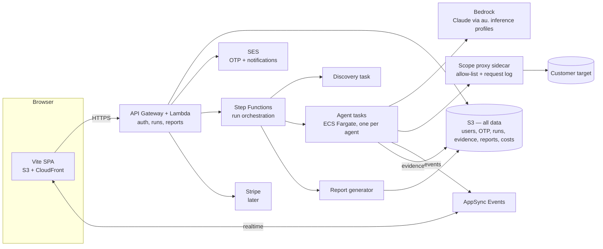

# Swarm — Self-Serve Product Plan

Turn the *simulated* swarm on the Fhloston Advisory marketing site into a real, self-serve product, **Swarm**, at its own dedicated domain, `fhlostonswarm.com` (registered in the swarm AWS account, with Google Workspace for human mailboxes): a customer signs in, points the swarm at their application, watches the agents work in real time, and receives a report like [example-report.html](./example-report.html).

> Status: **draft, all decisions made** (see [section 16](#16-decisions-log)); remaining actions and numbers to tune are in [section 17](#17-launch-checklist--items-still-to-tune). The phased build and verification plan is in [IMPLEMENTATION.md](./IMPLEMENTATION.md).

## 1. What we are building

| Area | Summary |
|------|---------|
| **Web app** (Vite) | OTP email login → intake form → live "swarm" view → report download; account/data deletion |
| **Staff dashboard** | `@fhlostonswarm.com` logins only: per-run cost analysis, usage, support tools |
| **Backend** (AWS, `ap-southeast-2`, account `885922397779`) | Auth, run orchestration, sandboxed agent execution on Bedrock, event streaming, report generation. **All data in S3.** |
| **Agent runtime** | Driven by the baseline methodology in [instructions/](./instructions/README.md), adapted per target by a discovery phase |
| **Entitlements / payments** | Every run (one-off or scheduled) consumes a paid credit of its scan depth (Scout, Sweep, Probe or Siege) via Stripe; staff can grant complimentary credits for testing and beta |
| **Saved scans** | A scan saves the target, logins, scan depth, schedule (one-off, daily, weekly, monthly, yearly) and a notification email, so it can be re-run or repeated without reconfiguring |

**Branding:** Swarm has its own brand and does not reuse the Fhloston Advisory look or name. "Fhloston Advisory" is not part of the product name, domain, logo, email sender names, report titles or UI copy; the only mention allowed is the attribution "a Fhloston Advisory product" in the footer/ToS. The marketing-site simulation is a functional reference only. Starting direction (to iterate on): **modern, exciting, AI/tech theme** — dark UI, neon/electric accents with soft glow, glassy panels, monospace/terminal touches, generative "swarm" motion. M1 ships a placeholder identity (wordmark + palette + design tokens in one theme file) so it's cheap to change later.

### What the marketing-site simulation tells us (reviewed from its JS bundle)

The site is a client-rendered SPA, so the simulation lives in its bundle. Key facts to reuse:

- **5 areas:** Recon (DNS/WHOIS/CT) · OWASP Top 10 & TLS · AuthN/AuthZ & API · LLM Top 10 · Logic/IDOR/privesc — these map 1:1 to phases 1–5 in [instructions/](./instructions/README.md).
- **12 agents:** `dns`, `surface`, `bundle` (recon); `tls`, `zap`, `cors` (unauth); `authn`, `session`, `authz` (authn); `prompt`, `output` (llm); `idor` (logic). Each has a colour, a "face" (visor / round / cyclops / hex / ears) and a list of steps.
- **Event model:** `dispatch → start(step) → finish(step: clear | info | finding | gap) → verify(finding) → agent-done → complete`. Findings are *candidates* until an independent agent cross-checks them. `gap` = something we could not test (reported as a scope limitation).
- **UI state:** per-agent status/current task/tag/progress, per-area progress bars, a findings list with severity + verified flag, an event log, and a "checks completed" counter.

**Key design move:** make this event schema the **contract** between backend and UI. Build the UI first against a *replay of the simulated feed* (same schema), then swap in the real event stream with no UI changes. It also gives us a demo/replay mode for free.

## 2. Architecture overview



**Principles**

1. **Per-run isolation.** Every run gets its own S3 prefix and ephemeral Fargate tasks. Nothing is shared across customers.
2. **Agents are untrusted by design.** The target is hostile (prompt injection via page content is expected). Agents have a tool allow-list, no AWS permissions beyond writing their own run's events/evidence, and egress only through a scope-enforcing proxy.
3. **Scope is enforced by the platform.** Agents can only reach the hosts the customer declared (see [section 6](#6-scope-enforcement--abuse-prevention)). Target ownership verification is deferred for now but designed in.
4. **Events are the source of truth.** The UI, the report and scheduled-run diffs are all derived from an append-only run event log.
5. **Everything in IaC** (AWS CDK, TypeScript) and deployable within the one swarm account (a single environment; any future dev/stage would be a separate account).
6. **Zero idle cost.** With no scans running, the only things that exist are S3 data, serverless request-driven services (CloudFront, API Gateway, Lambda, AppSync Events, Step Functions, SES) and a few small fixed items (Route 53 zone, logs). No always-on compute, no NAT gateway, no interface VPC endpoints, no WAF at launch, no provisioned capacity. Details and an estimate in [section 14](#idle-cost-at-rest).

## 3. Repository layout

`src/` is reserved for the application (per repo conventions); `utils/` + `swarm.ts` remain the ops CLI. Use npm workspaces:

```
src/
  web/        Vite + React + TS SPA
  api/        Lambda handlers (auth, runs, reports, billing)
  agents/     Agent runtime (container image), tool implementations, prompts loader
  infra/      AWS CDK app (stacks: edge, auth, data, runs, agents, reports, billing)
  shared/     Types: run events, findings schema, API contracts (zod)
docs/         Plan, implementation notes, prerequisites, sample prompts, example report, email drafts
  instructions/ Baseline methodology (existing) — versioned + bundled as agent prompt templates
utils/        Existing CLI (swarm login, later: swarm deploy / swarm run-local)
```

## 4. Web app (Vite)

**Stack:** Vite + React + TypeScript, TanStack Query for API state, Zustand (or similar) for the live run store, Zod for shared contracts. Hosted on S3 + CloudFront at **`fhlostonswarm.com`** (API under the same host, e.g. `/api/*`, so cookies stay first-party).

### Screens

1. **Login** — one page: email, "Email me a code", and a code field that also takes a test passcode (so a scan's browser can sign in without email). No passwords. A new account holds no credits until it buys some.
2. **Dashboard** — past runs, status, report links, credits held per scan depth, "New assessment", per-run **Run again** and **Delete** actions.
3. **New assessment (intake)** — creates a **saved scan** and starts its first run ([section 13](#13-saved-scans-schedules--notifications)):
   - Application URL (required) and marketing/landing page URL (optional). Their hostnames become the run's allowed scope.
   - **Scan depth** shown up front as four cards from shallow to deep (**Scout**, **Sweep**, **Probe**, **Siege**), each showing the agents it runs, how many logins it uses, and the time it takes ([section 11](#11-scan-depths-tiers-entitlements--payments)). Prices are shown at checkout once payments exist.
   - **Schedule:** one-off (default), daily, weekly, monthly or yearly. Different scans on the same application can use different depths, for example Scout daily, Sweep weekly and Siege monthly.
   - **Notifications:** the email that receives the report notice (defaults to the account email, set per scan) and when to send it (after every run, only on new findings, or never).
   - **Test logins** — four fixed slots with a free-text *description of permissions* each. The depth sets how many are used (Scout none, Sweep 1, Probe 2, Siege 4); the form asks for at least one for any depth above Scout and refuses more than the depth uses:

     | Slot | Typical meaning | Maps to tier in [instructions/README.md](./instructions/README.md#4-login-access-levels) |
     |------|-----------------|------|
     | `admin` | Full administrative access | Admin |
     | `user1` | Normal user | Standard |
     | `user2` | Second normal user *(enables horizontal-escalation tests)* | Standard (2nd) |
     | `other` | Different permissions (read-only, manager, support…) | Read-only / Elevated |

     Each slot: username, password, description, optional notes (MFA, login URL, quirks). The form says clearly: use staging/test credentials, never production. Fewer logins than a deep scan could use is allowed (reduced coverage is recorded as a `gap`).
   - Optional: scope notes ("don't touch /billing"), known-safe test data, rate-limit preference, staging-vs-prod warning.
   - Authorization acknowledgement (checkbox + timestamp + IP stored): "I am authorised to test these systems."
4. **Live swarm view** (the hero)
   - Futuristic canvas: agents render as glowing faces swarming around the target "core", with beams/pulses when an agent probes an endpoint, colour-coded by area (reuse the site's 12-agent palette/faces).
   - Side panels: per-area progress, live findings (severity + verified badge), event log, checks counter, coverage meter (percent of planned work covered; never dollars, tokens or caps, see [revenue.md](./revenue.md#2-stop-exposing-cost-to-customers)).
   - Tech: PixiJS (WebGL) or plain Canvas 2D for the swarm; React for panels. Respect `prefers-reduced-motion` and provide a low-power mode.
   - Click an agent → its current task and recent steps.
5. **Report** — in-app HTML view, download HTML / PDF / JSON (and SARIF later).
7. **Scans** — the saved scans: depth, cadence, notification email, status, last and next run. Each can be **run again**, paused or resumed (recurring ones), or deleted, without reconfiguring. Editing a scan (target, logins, depth, schedule, notification email) reuses the same form ([section 13](#13-saved-scans-schedules--notifications)).
8. **Account / data** — delete an individual run (and its report/evidence), or **delete account** (removes everything, see [section 14](#14-security-privacy--operations)).
9. **Staff dashboard** (`/staff`, only visible to `@fhlostonswarm.com` logins) — see [section 12](#12-staff-support-dashboard--cost-tracking).

### Realtime transport

Use a managed pub/sub rather than hand-rolling WebSockets: **AppSync Events** (one channel per run: `/runs/{runId}`), with the browser authorized via a short-lived token minted by the API. Fallback if we don't want AppSync: SSE from a Lambda function URL with response streaming (no connection table needed). AppSync Events is transport only, not storage. On reconnect the UI first loads the event log from S3 then resumes the live stream (event `seq` numbers make this idempotent).

## 5. Auth: email OTP via SES

### Recommendation on email delivery: **SES, not Google Workspace SMTP**

- Workspace SMTP/relay has per-user/day caps, is tied to a human mailbox/app password, and is poor for deliverability monitoring/bounce handling. SES is built for transactional mail, has bounce/complaint events, and fits the AWS stack.
- **SES and Google Workspace coexist fine.** Both run on the dedicated **`fhlostonswarm.com`** domain: Google Workspace owns the apex MX/SPF/DKIM for human mailboxes (including `support@` and staff addresses), while SES sends Swarm mail from the same domain with its own DKIM and a custom MAIL FROM subdomain (`bounce.`) so its SPF doesn't collide with Google's. All of this DNS lives in our Route 53 zone in the swarm account (see DNS below).

### SES setup (ap-southeast-2) — one-time

1. Create a **domain identity** for `fhlostonswarm.com` with **Easy DKIM** (3 CNAMEs).
2. Configure a **custom MAIL FROM** subdomain (e.g. `bounce.fhlostonswarm.com`: MX → `feedback-smtp.ap-southeast-2.amazonses.com`, TXT SPF `v=spf1 include:amazonses.com ~all`) for DMARC alignment.
3. Publish/verify **DMARC** (`_dmarc.fhlostonswarm.com` TXT, shared with Google Workspace mail) — start `p=none` with `rua` reporting, move to `quarantine` once clean (only after both Google and SES mail pass SPF/DKIM alignment).
4. **Request production access** (out of the SES sandbox) — do this early; it takes ~1 day. Describe: OTP + transactional only, bounce/complaint handling, opt-in only.
5. Create a **configuration set** with event destinations (bounce/complaint/delivery → SNS → Lambda that writes a suppression list object to S3, `suppression/{emailHash}.json`).
6. Send from `login@fhlostonswarm.com`; set `Reply-To: support@fhlostonswarm.com` (a Google Workspace mailbox/group).

### DNS (decided: dedicated domain `fhlostonswarm.com` in the swarm account)

Swarm gets its own domain, **`fhlostonswarm.com`**, registered in the swarm AWS account (885922397779), so everything (registration, DNS, certificates, CloudFront, SES) lives in one account. A Route 53 public hosted zone for it already exists in that account, and it is the authoritative zone (the domain's name servers must point at it). There is **no cross-account step and no manual DNS work** beyond pasting the Google Workspace values below into config.

CDK looks up the existing hosted zone (`HostedZone.fromLookup`, not create) and manages all records in it: apex alias → CloudFront (A/AAAA), ACM certificate validation, SES DKIM, MAIL FROM, DMARC, and the **Google Workspace records** — the five Google MX records, apex SPF TXT (`v=spf1 include:_spf.google.com ~all`), the `google-site-verification` TXT, and the `google._domainkey` DKIM TXT. The verification and DKIM values come from the Workspace admin console and are supplied as CDK config. The only fixed DNS items are the hosted zone and the domain registration/renewal (enable auto-renew).

### OTP flow

1. `POST /auth/request {email}` — normalize email, always respond identically (no user enumeration), rate-limit per email + IP, send a 6-digit code (also include a magic link `fhlostonswarm.com/auth/verify?token=…`).
2. Code: CSPRNG, stored **hashed** (HMAC) with 10-minute expiry, max 5 attempts, single use. (Storage: S3, see below.)
3. `POST /auth/verify {email, code}` → issue a session: signed JWT (`jose`) in an `HttpOnly; Secure; SameSite=Lax` cookie, short-lived (e.g. 12h) with refresh via a rotating refresh token stored server-side (revocable → fixes the "no server-side logout" finding we routinely report on others).
4. CSRF protection for cookie-authenticated mutating calls (double-submit token or `SameSite=Strict` + origin check).
5. Turnstile/hCaptcha on `auth/request` to protect SES reputation (optional but recommended).

### Auth approach (decided): custom OTP + `jose` JWT

A small custom OTP module plus `jose` JWTs, framework-agnostic (Hono on Lambda). Passport.js was considered but adds little here (OTP logic is ~150 lines, API runs on Lambda); Cognito was rejected (clunky, and doesn't fit the S3-only user store). A Passport strategy could be added later if social login is wanted.

### Where data lives: S3 only (decided)

Everything lives in one S3 bucket (`swarm-data-885922397779`), default encryption (SSE-S3), block public access, versioning **off** (so deletes really delete). No DynamoDB. The atomic operations we need are covered by S3 **conditional writes**: `If-None-Match: *` (create only if absent) and `If-Match: <etag>` (compare-and-swap update).

```
users/{emailHash}/profile.json              user profile (plain email, created, role: customer|staff)
users/{emailHash}/entitlements.json         credit ledger per scan depth (purchased, staff-granted, consumed)
users/{emailHash}/targets/{targetId}.json   saved target: URLs, scope notes, logins, ToS ack (see section 13)
users/{emailHash}/scans/{scanId}.json       saved scan: targetId, tier, schedule, notification email + confirmation, login slots used, status
users/{emailHash}/runs/{runId}/input.json   snapshot of the target + scan at start: URLs, scope, logins, tier, trigger, scanId, ToS ack
users/{emailHash}/runs/{runId}/summary.json small run summary the dashboard lists (status, counts, tier, timestamps, scanId, trigger)
users/{emailHash}/runs/{runId}/credit.json  marks the run's credit spent (or waived for staff); created first, so a run id is used once
users/{emailHash}/runs/{runId}/events/...   append-only event chunks (seq-numbered objects)
users/{emailHash}/runs/{runId}/evidence/... HAR, screenshots, tool output
users/{emailHash}/runs/{runId}/report/...   report.html, report.pdf, findings.json
users/{emailHash}/runs/{runId}/cost.json    token/compute usage + estimated cost (see section 12)
users/{emailHash}/sessions/{sessionId}.json refresh tokens (revocable)
auth/otp/{emailHash}.json                   current OTP challenge (hashed code, expiresAt, attempts)
auth/ratelimit/{emailHash|ipHash}/{window}.json  coarse counters
auth/notify-confirm/{tokenHash}.json        pending confirmation of a notification address (section 13)
suppression/{emailHash}.json                SES bounce/complaint suppression
admin/run-index/{yyyy}/{mm}/{dd}/{runId}.json   anonymised per-run summary, cost and what the run consumed (so it can be costed again) for the staff dashboard
admin/audit/{yyyy}/{mm}/{dd}/{id}.json     staff actions (credit grants, controls, price tables, deletions): account hash, never the customer's email; survives account deletion
admin/settings/controls.json                the controls staff edit: kill switch, concurrency, depth caps, spend alarm, scheduled-scan limits, block lists (section 12)
admin/pricing/{current.json,versions/<version>.json}   the price table in force and every saved version (section 12)
admin/spend/{yyyy-mm-dd}.json               the day's estimated spend so far, for the daily spend alarm
admin/pools/…                               per-depth concurrency pools (section 11)
```

How each requirement maps onto S3:

| Need | Approach |
|------|----------|
| OTP single use, max 5 attempts | `auth/otp/{emailHash}.json` updated with `If-Match` (compare-and-swap) on each attempt; delete on success. Expiry is enforced in code via `expiresAt`; an S3 lifecycle rule (1-day minimum) is the backstop cleanup. |
| Rate limiting | Coarse per-email/IP window counters via the same compare-and-swap, **plus** API Gateway throttling and Turnstile/hCaptcha on the auth endpoints (S3 is the wrong tool for per-request limiting). A WAF with rate-based rules is an optional add-on if abuse appears (see [section 14](#idle-cost-at-rest)). |
| A credit consumed exactly once | Starting a run writes a consumption marker for that run with `If-None-Match: *` and updates `entitlements.json` with `If-Match`; a retry or a concurrent start gets `412` and cannot spend the same credit twice. Scheduled runs use the same path, keyed by scan and scheduled time. |
| Listing a user's runs and scans | `LIST users/{emailHash}/runs/` and `…/scans/` — cheap at this scale; the dashboard reads each run's small `summary.json` and each scan's small config object. |
| Staff cost view | Per-run summary written to `admin/run-index/...` (anonymised), plus daily rollups. Athena over the bucket is a later option if volume grows. |
| Account deletion | Everything per-user sits under `users/{emailHash}/`, so deletion is one prefix delete (see [section 14](#14-security-privacy--operations)). |

Trade-offs accepted by going S3-only: no TTL (handled in code + lifecycle), no atomic counters (compare-and-swap with retry), no secondary indexes (prefix layout + index objects). All fine at this scale; revisit if run volume or auth traffic grows large.

- **Key:** `emailHash = HMAC-SHA256(pepper, normalizedEmail)` (pepper in an SSM Parameter Store SecureString — standard tier is free, unlike Secrets Manager's per-secret monthly fee). Normalize: trim, lowercase, strip `+tag`, and for Gmail/Google-hosted domains collapse dots, so one mailbox is one account. Block known disposable-email domains (they also cost us OTP mail and give throwaway accounts).
- Store the plain email only in `profile.json` (needed to send mail).
- **Staff role:** derived at login — after a successful OTP, if the normalized email's domain is exactly `fhlostonswarm.com` the session gets `role: staff`. OTP proves mailbox control, so only people who can read `@fhlostonswarm.com` mail (Google Workspace) can get it. Exact domain match only (no subdomains, no look-alikes). Shared/role addresses (`support@`, `login@`, `admin@`, `postmaster@`, etc., which may be Workspace groups readable by several people) are denied as login identities; staff use named personal mailboxes.

### Incoming email / support

Inbound email is handled by **Google Workspace on `fhlostonswarm.com`** (`support@fhlostonswarm.com` as a group/mailbox for humans; MX records in our Route 53 zone). Swarm only sends mail (OTP, "report ready") via SES, with `Reply-To: support@fhlostonswarm.com`. No SES inbound, no ticketing integration yet.

## 6. Scope enforcement & abuse prevention

A self-serve tool that attacks customer-supplied URLs can be misused. **Decision: no target ownership verification for now** — customers declare the targets and tick an authorisation acknowledgement. Because that removes the strongest control, the remaining ones matter more:

1. **Scope enforcement in the platform, not just the prompt:** all agent traffic goes through an egress proxy that only permits the hostnames the customer declared (application URL + optional marketing URL, plus any explicitly listed API hosts). It also gives us full request logging (evidence + audit trail). Out-of-scope hosts discovered during recon are *noted, not touched* (as the site's simulation already does).
2. **Non-destructive, rate-limited by default:** per-run requests-per-second cap, no DoS/high-volume fuzzing tools, agents told to avoid delete/payment/email-sending actions and the tool layer blocks the obvious ones.
3. **Terms + authorization acknowledgement** stored with timestamp/IP/email (in `input.json`). Customer confirms they are authorised to test and accept impact; the form recommends staging and says never to use production credentials.
4. **Abuse controls:** per-user/day run caps, global concurrency cap, block lists (gov/critical-infra, our own domains (staff may scan these), other well-known third-party SaaS/CDN hosts, cloud metadata IPs), RFC1918/link-local/IMDS blocked at the proxy (stops SSRF *from* our runners), kill switch (global + per-run, available in the staff dashboard), customers can press **Stop** at any time.
5. **Every run needs a credit:** every run, one-off or scheduled, consumes a paid (or staff-granted) credit, so throwaway email accounts get no scanning and cannot spam the system with requests. The cheap **Scout** depth is passive and unauthenticated, and the proxy still enforces hard time/request/spend caps per depth (see [section 11](#11-scan-depths-tiers-entitlements--payments)). Because scans can repeat, scheduled runs also get a per-account cap on how many may be active and a minimum spacing (see [section 13](#13-saved-scans-schedules--notifications)).
6. **Simple identification, no fixed egress IPs:** requests carry `User-Agent: Swarm/<version> (+https://fhlostonswarm.com/about)`. Customers start the scan themselves against their own staging site, so recognising or allow-listing our traffic isn't our concern, and we don't need fixed egress IPs (which would require an always-on NAT gateway).
7. **Verification later (designed in, switched off):** the `input.json` schema reserves `targetVerification: { method: dns|file|meta, verifiedAt }`, and the proxy takes its host list from a single allow-list function, so adding "prove you own it" (DNS TXT / `/.well-known` file / meta tag) before active testing is a small change. Recommended before heavy public launch or any paid active/authenticated testing at scale.

## 7. Backend: running the agents on AWS

### Run lifecycle (Step Functions state machine)

1. **Create run** — validate input, spend one credit of the scan's depth (a staff run is exempt but flagged), snapshot inputs from the saved target and scan (including test credentials, see below) and resolve the tier's agent group and budgets. A run is started by a customer (new or re-run of a saved scan) or by the scheduler (`trigger: manual | scheduled`); both take the same path.
2. **Phase 0 — Discovery** (new, dynamic): one agent fingerprints the target and produces the **engagement plan** (see [section 8](#8-dynamic-instructions--discovery-phase)).
3. **Fan-out** — launch the planned agents as parallel **ECS Fargate tasks** (Map state), grouped by methodology phase. Phases that depend on earlier output (authenticated testing needs login validation, business logic needs the authz map) run after their prerequisites.
4. **Verification** — for each candidate finding, an *independent* verifier agent reproduces it and attaches evidence; unverifiable candidates are downgraded/marked "unconfirmed" (matches the site's "cross-checked by independent agents" step).
5. **Report assembly** — merge findings, de-duplicate across phases, render outputs.
6. **Notify** — SES email "your report is ready"; update run status; expire resources.
7. **Learn** — after the PDF, a short learning pass reviews the closed run and may publish a new version of the dynamic layer ([section 9](#9-the-learning-loop)); best effort, it never changes the run.

Why Fargate (not Lambda): browser automation (Playwright), ZAP/nuclei/testssl-style tooling and long LLM tool loops exceed Lambda's 15-minute limit and need a real filesystem/binaries. Alternatives to evaluate: **Bedrock AgentCore Runtime** (managed agent hosting/isolation) once its fit and regional availability are confirmed.

### Agent runtime

- **Container image** with: Node/TS agent loop, Playwright + Chromium, a curated set of CLI tools (ZAP baseline, testssl, nuclei, dig/whois, subfinder-style CT lookups). Tools are exposed to the model as typed functions — the model never gets a raw shell on a shared box.
- **Models (decided):** Claude via **Amazon Bedrock** in `ap-southeast-2`, using the **`au.` (Australia) cross-region inference profiles** so inference stays in Australian regions (avoid `global.` profiles; useful for the privacy story). **No Opus-class models** for the scans themselves — they add cost without meaningful benefit for this work (the one exception is the post-run learning pass of [section 9](#9-the-learning-loop), which runs once per run on the most capable model available). Sonnet-class is the workhorse for the deeper scans, **Probe** and **Siege** (exploration, exploitation reasoning, verification, report writing); Haiku-class for the shallower **Scout** and **Sweep** scans and for high-volume/simple steps in any depth (recon, summarising tool output). Profiles seen `ACTIVE` in the swarm account (checked with `aws bedrock list-inference-profiles`):

  | Role | Initial default | Newer options also listed |
  |------|-----------------|---------------------------|
  | Probe and Siege / workhorse | `au.anthropic.claude-sonnet-4-6` | `au.anthropic.claude-sonnet-5`, `au.anthropic.claude-sonnet-5-5` |
  | Scout and Sweep / simple steps | `au.anthropic.claude-haiku-4-5-20251001-v1:0` | `au.anthropic.claude-haiku-5-5` |

  Initial defaults are conservative choices. The benchmark harness (`benchmark.live` in `src/agents`) runs a Siege against the synthetic target per model and scores the discovery rubric, the findings against `expected.json`, cost and time. On that target Sonnet 4.6 and Haiku 4.5 both found all 19 seeded issues, Haiku at about a fifth of the cost, so it cannot tell them apart and Sonnet 4.6 stays the default for Probe and Siege until a harder target can; Sonnet 5 and 5.5 are listed but `AccessDenied` for the swarm account, so they are not compared yet. Model IDs live in tier config, so switching is a config change, and the price table in [section 12](#12-staff-support-dashboard--cost-tracking) is keyed by model. **Invocation is not yet usable:** a test call was rejected because the AWS account is still being verified (see [section 17](#17-launch-checklist--items-still-to-tune)).
- **Framework:** Strands Agents SDK (TS/Python) or a thin custom loop over the Bedrock Converse API. Start with a thin loop (we control tool-calling, budgets and event emission); revisit.
- **Budgets per agent/run:** max steps, max tokens, wall-clock timeout, max requests, set per tier (scout < sweep < probe < siege). Hitting a budget emits a `gap`, not a silent stop.
- **Usage metering:** every Bedrock Converse call returns token usage; every agent task records start/stop and vCPU/memory size. The agent runtime writes these to the run's `cost.json` (see [section 12](#12-staff-support-dashboard--cost-tracking)).
- **Isolation:** one task per agent per run, no inbound (security group denies all ingress), tasks destroyed after run. To avoid an always-on NAT gateway and interface VPC endpoints, tasks run in **public subnets with a public IP** (internet access via the free internet gateway; S3 via a free gateway endpoint) and a **scope-proxy sidecar container in every task** enforces the host allow-list, blocks private/link-local/metadata addresses (including the ECS task metadata endpoint) and logs requests; the agent container can only reach the network through the sidecar (task-local networking + egress security-group rules). Task role scoped to `users/{emailHash}/runs/{runId}/*` and event publish for that run, read-only root FS where possible.
- **Prompt-injection hardening of our own agents:** treat all target content as untrusted data, wrap tool output in delimiters, no tool that can reach other runs/customers, never let model output choose the host (scope proxy decides), and output validated against schemas before it becomes an event/finding.

### Customer test credentials (keep it simple)

We tell customers to supply **staging/test credentials, never production** (stated on the intake form and in the ToS), so these are treated as low-sensitivity test data, not secrets.

- Stored with the saved **target** (`users/{emailHash}/targets/{targetId}.json`) and copied into each run's input file in S3 (`users/{emailHash}/runs/{runId}/input.json`), both with default S3 encryption (SSE-S3), like the rest of the run data. No KMS, no Secrets Manager.
- Agents read them directly from the run input and can use them as needed (login, fill forms, API auth). No special `login(role)` injection layer.
- Basic hygiene only: don't print passwords in the customer-facing report or public log lines. The API never returns a saved password to the browser (editing a scan shows "saved" and only replaces it when a new one is typed). They are removed when the customer deletes the target, run or account.
- Re-runs and scheduled runs reuse the credentials stored with the target; the customer can update or remove them at any time, and every scan on the target picks up the change.

### Event streaming & storage

- Each agent emits events (`seq`, `ts`, `runId`, `agent`, `type`, payload) to an API that (a) writes seq-numbered chunk objects under `users/{emailHash}/runs/{runId}/events/` in S3 (S3 can't append, so small batched objects, merged into one `events.jsonl` when the run completes), (b) updates the run's `summary.json` (status, counts, tier, timestamps), (c) publishes to the AppSync channel.
- Evidence (HAR, screenshots, tool output) → `users/{emailHash}/runs/{runId}/evidence/{phase}/…` mirroring the layout in [phase-6-reporting.md](./instructions/phase-6-reporting.md); customer-visible versions are redacted. Agent task roles are scoped to their own run prefix.

## 8. Dynamic instructions & discovery phase

The existing [instructions/](./instructions/README.md) are a **baseline playbook**, written for a human-plus-AI engagement (fixed engagement under `2026/assessment1`, "Instructions for Human Tester", manual sign-off). To run unattended and adapt per target:

1. **Productise the baseline.** Convert each `phase-N-*.md` into a versioned **prompt module** with explicit sections: *objective, guardrails (immutable), checks, tools, evidence format, output schema*. Store in S3 (versioned) / bundled in the agent image; record the `instructionsVersion` on each run for reproducibility.
2. **Discovery (Phase 0):** a planner agent crawls the app (unauthenticated, then with each login the scan's depth uses; Scout and Sweep are bounded by the page cap) and classifies it: SPA/server-rendered, API style (REST/GraphQL), auth mechanism (session cookie / JWT / OAuth), tech stack, presence of AI/LLM features, file uploads, payments, multi-tenancy, roles. Its output is the "what we understood about your application" section of every report.
3. **Engagement plan:** the planner emits `engagement.json` (schema-validated): which agents to run, which checks to enable/skip (e.g., skip Phase 4 if no LLM features — recorded as "not applicable" in the report), role-specific test matrices from the customer's login descriptions, target-specific hints (routes, API base URLs), and estimated budget.
4. **Constraints on adaptation:** the planner can add/remove/reorder checks but **cannot** remove guardrails, widen scope, or change the allowed-tool list. Plan is shown to the customer. Between runs the instructions themselves keep learning ([section 9](#9-the-learning-loop)).
5. **Replace human sign-off points** with: automated verifier agent + explicit "unverified" label. Reports are **automated only** for now (no analyst review step); the report says so.
6. The instruction files carry no engagement-specific content (no target URL, credentials or paths); `tasks.md` is a template for the checklist generated per run rather than a hand-edited file.

## 9. The learning loop

Runs execute unattended in the background, so the swarm adapts between runs rather than during one: the hard-coded instruction modules are only a **baseline**, and a **dynamic layer** of instructions and agents, stored in S3, is revised by a short learning pass after every run, run by the most capable model available, so the swarm stays current as new risk categories and high-risk issues appear, without code changes.

- **Baseline (code, immutable):** guardrails, the typed-tool allow-list, the scope proxy, the 12-agent roster and the instruction modules of [section 8](#8-dynamic-instructions--discovery-phase). Nothing learned can remove, weaken or override them.
- **Dynamic layer (S3, global, versioned):** *knowledge items* (a risk category or technique with the technologies it applies to, its source and date) and *dynamic agents* (declarative specs whose checks are built only from the existing read-only typed primitives, so they inherit the scope proxy and the run's caps). Planner and agents receive the relevant items next to the baseline modules, and each run records the `dynamicVersion` it used.
- **Learning pass:** after the run closes, a short model call **reviews that run** (a size-bounded digest of its technology profile, plan, gaps, finding categories, verifier outcomes, dynamic-item results and the surface no check covers, read only from that run's own data) together with the current layer and fresh content from allow-listed sources (OWASP Top 10, OWASP LLM Top 10, CISA KEV, vendor advisories, best-practice sites). It proposes additions, revisions and retirements, including new agents, learning for example from a check that keeps going unconfirmed or from a technology nothing covers. Whatever it proposes must be generic: any proposal containing a host, path, identifier, credential, evidence or customer wording from the run is rejected, and the digest itself is never stored. Generic learnings are kept when a run or account is deleted, which the privacy notice states. Source content is untrusted data and cannot choose hosts, tools or limits.
- **Bounded:** configured caps on active items, on **dynamic agents** (globally and per depth, taken from the depth's own time and spend caps, none in Scout and Sweep), on changes per pass and on the pass's own time and spend. When full, a new agent replaces the lowest-scoring one; anything that does not apply or fire for a set number of runs, or whose source is superseded, is retired.
- **Safe promotion:** new items and agents start as candidates in shadow mode (observations only) and become active only after staying in scope and passing the synthetic-target regression. Every version and proposal is logged and reversible, staff can pin, disable or roll back, and a kill switch falls back to the baseline.
- **Visible:** the report's methodology lists the dynamic items and agents used, with their source and date.


## 10. Report output

- Source of truth: `findings.json` (schema: id, title, severity, CVSS/OWASP/LLM-Top-10 mapping, affected component, description, evidence refs, reproduction steps, remediation, status [open/accepted/unverified], verified flag, agent, phase).
- Renderer: HTML template reproducing [example-report.html](./example-report.html) sections: 1 Executive Summary · 2 Positive Findings · 3 Scope & Methodology · 4 Testing Performed (per phase) · 5 AI/LLM Testing · 6 Technical Findings · 7 Static Code Analysis (n/a unless source supplied) · 8 Informational · 9 Recommended Priorities. Plus **Scope limitations / gaps** (from `gap` events and missing logins).
- Exports: self-contained HTML, **PDF** (headless Chromium in the report task), JSON; SARIF/CSV later.
- LLM writes prose (exec summary, remediation) **from validated findings only**; numbers (counts by severity) are computed, not generated.
- Redaction pass: test passwords, tokens, cookies, PII and verbatim jailbreak output are scrubbed from customer-facing output (per [phase-6-reporting.md](./instructions/phase-6-reporting.md)); raw evidence stays in the private run prefix.
- **Every depth gets the full report format.** Depth changes *what is tested*, not what is shown: a Scout report is complete for the checks it ran and lists the areas it did not cover ("not included at this depth") so the customer can see what a deeper scan would add.
- Delivery: presigned S3 URLs behind an authenticated API call. Reports are kept until the customer deletes the run or their account (no automatic expiry yet).
- Clear disclaimer: **automated**, AI-assisted assessment (no human review); not a certification or a substitute for a full manual penetration test (positioning vs. a human-led engagement). Shallower depths say plainly which areas they did not cover.

## 11. Scan depths (tiers), entitlements & payments

**Every run needs a credit.** Every run, whether a one-off report or one firing of a schedule, consumes a paid credit, so throwaway email accounts cannot spam the system with scan requests. The cheapest depth (Scout) is priced low enough to be a real entry point.

### Scan depths

A **tier is a scan depth: a named group of agents** from the 12-agent roster ([section 1](#what-the-marketing-site-simulation-tells-us-reviewed-from-its-js-bundle)). Each deeper tier runs every agent of the one before it, plus more, with more logins, and a longer time allowance. Cost and price rise with depth. The customer picks a depth per scan, so one application can be covered by a light scan often and a deep one rarely, for example **Scout daily, Sweep weekly and Siege monthly**, or a one-off Siege before a launch.

| Depth | Name | Agents (areas) | Logins | Time allowance | Model class | Good for |
|---|---|---|---|---|---|---|
| 1 | **Scout** (shallow) | `dns`, `surface`, `tls`, `cors` (recon + unauthenticated, passive) | 0 | 10 min | Haiku | Daily "is anything newly exposed?" checks |
| 2 | **Sweep** | Scout + `bundle`, `zap`, `authn` (all passive checks plus a sign-in review) | 1 | 20 min | Haiku | Weekly regression checks |
| 3 | **Probe** | Sweep + `session`, `authz`, `prompt`, `output` (authenticated testing across two roles, access control, LLM checks) | 2 | 40 min | Sonnet | Monthly reviews |
| 4 | **Siege** (deep) | Probe + `idor` (all 12 agents, business logic and privilege escalation, all four logins) | 4 | 60 min | Sonnet | One-off full reports, yearly assessments |

The suggestions in "Good for" are guidance only; any depth can be used with any schedule. Names and groupings are data (`src/shared/config/tiers.json`, validated by `tiersConfigSchema`: each tier must contain every agent of the shallower one, and logins and depth must not fall as depth rises), not code. Every depth produces the same report format; shallower ones list the areas they did not cover.

### Entitlements

- Every run consumes **one credit of the scan's depth**. Credit sources: `purchase` (Stripe, Phase 11), `comp` (granted by staff for testing and the private beta, audit-logged) and, for scheduled runs, `subscription` (prepaid or billed per run). The ledger is an S3 object per user (`users/{emailHash}/entitlements.json`, compare-and-swap updates). A run's credit is consumed with a conditional create, so it can never be spent twice ([section 5](#where-data-lives-s3-only-decided)).
- Staff accounts can start runs without a credit (internal testing); those runs are flagged and their cost is tracked like any other.
- A scheduled run that fires with no credit (or a failed payment) is **skipped, not queued**; the owner is emailed once and the scan stays saved, so topping up and re-running is one click.
- If a run fails for platform reasons the credit is returned exactly once.

### Initial tier limits

Best-judgement starting values; all tunable from real `cost.json` data ([section 12](#12-staff-support-dashboard--cost-tracking)). **Caps are internal, not product features:** they live in server-only config (`src/shared/config/limits.json`, exposed only through `@swarm/shared/server`; the contract test fails if any appears in a customer payload or in the browser bundle). Spend caps must not fall as depth rises.

| Setting | Scout | Sweep | Probe | Siege |
|---------|-------|-------|-------|-------|
| Model | Haiku-class | Haiku-class | Sonnet-class | Sonnet-class |
| Page / LLM step cap | 40 pages, 60 steps | 80 pages, 120 steps | per-agent budgets | per-agent budgets |
| Request cap / rate | 300, ≤2 req/s | 800, ≤3 req/s | 1,800, ≤4 req/s | 3,000, ≤5 req/s |
| Token cap | ~600k in / 30k out | ~1.5M in / 60k out | per-agent budgets | per-agent budgets |
| Hard spend cap per run | **≈ US$1** | **≈ US$3** | **≈ US$8** | **≈ US$15** |
| Concurrency | 4 at once | 3 | 2 | 2 |

Dollar caps are estimates to be checked against the current Bedrock price list once invocation works; token and spend caps are enforced from the metered Converse usage, and a run stops when any cap is reached. Customers never see dollars, tokens, model names or caps in the UI, API responses or event stream. They see **coverage** (share of planned work done) and honest scope gaps. When a cap stops a run, the report says which areas were not covered ("coverage limit reached for this depth"), never "spend limit reached". Per-step dollar cost travels on a separate staff-only channel (section 12). See [revenue.md](./revenue.md).

### Payments and pricing

- **Stripe Checkout** (credits per depth, one-off) → webhook → credit. Stripe Tax for AU GST. Customer portal for invoices. Recurring scans either draw down prepaid credits or are billed per run through a subscription with metered usage.
- **Pricing: TBD, but ordered.** Price per run rises with depth (Scout lowest, Siege highest), set from measured cost per run (see [section 12](#12-staff-support-dashboard--cost-tracking)): `price ≈ measured_cost × margin`, plus a floor. Because a daily Scout run repeats 365 times a year, its price is checked against that annual volume, not just one run. [revenue.md](./revenue.md#4-product-ladder-packaging-ideas) holds the starting hypotheses.
- **Abuse controls:**
  - Nothing runs without a credit, so signup alone gives no scanning capability and no spend for us beyond the OTP email.
  - Disposable/temporary-email domain blocking (maintained list) and no `+tag`/dot aliasing keep one mailbox as one account.
  - Per-email/IP counters, API Gateway throttling and Turnstile/hCaptcha on signup (`/auth/request`) (add WAF IP/ASN rate rules later if needed).
  - Staff-granted `comp` credits are the only way to get a run without paying; they are issued by named staff, audit-logged and visible on the staff dashboard ([section 12](#12-staff-support-dashboard--cost-tracking)).
  - Per-account limits on active scheduled scans and a minimum spacing for repeats, a per-depth concurrency pool so cheap frequent scans cannot starve deep ones, and a global daily spend alarm ([section 13](#13-saved-scans-schedules--notifications)).

## 12. Staff support dashboard & cost tracking

A `/staff` area in the same app, only for sessions with `role: staff` (derived from an `@fhlostonswarm.com` email at login, see [section 5](#where-data-lives-s3-only-decided)). Staff API routes re-check the role server-side on every call; the SPA hiding the menu is not the control. Staff views never show customer test passwords by default.

**Per-run cost capture** (written by the agent runtime and orchestrator to `cost.json`, copied anonymised to `admin/run-index/…`). This data is **staff-only**: it is not on the customer event stream, summary or report, and staff routes serve it behind the server-side role check:

| Cost component | Captured from | Notes |
|----------------|---------------|-------|
| Bedrock tokens | Converse `usage` per call: input, output, cache read/write tokens, per model | Dominant cost expected. One meter serves the explorer and the planner (the only model callers), so it is per run and model, not per agent |
| Fargate compute | Task start/stop × vCPU/GB | One task runs every agent, so it is per run, not per agent |
| Egress data | Bytes via the proxy (public internet data transfer out) | Likely small |
| S3, AppSync, SES, Step Functions | Object/event/email counts | Likely negligible; estimated |
| **Estimated total** | Computed from a **price table** in config (`pricing.json`, values **TBD**/to be verified against current AWS prices) | Table versioned so old runs keep the prices used |

Optionally reconcile estimates against Cost Explorer using a `run` / `tier` cost-allocation tag on tasks.

**Dashboard views:**

1. **Runs** — table (time, depth/tier, trigger manual|scheduled, entitlement source purchase|comp|subscription|staff, status, duration, findings count, estimated cost); filter by date/depth/status/trigger/entitlement source.
2. **Run detail** — cost breakdown by component and model, token counts, steps, budget used vs cap, per-agent activity (checks, requests, findings, gaps), gaps/budget-exhausted agents, event log. Useful for tuning budgets and diagnosing bad runs.
3. **Cost analysis** — avg/median/p95 cost per run by depth; total spend by day; cost of staff-granted (`comp`) vs paid runs; **annualised cost of each recurring cadence** (for example a daily Scout is 365 runs a year); cost per finding; the most expensive runs and where the cost goes (model, compute, data out, orchestration, learning passes). Includes a **pricing worksheet**: input a margin and a floor → suggested price per depth, vs the **TBD** placeholders, and a versioned **price-table editor** that previews its effect on past runs before it is saved.
4. **Users / support** — look up a user by email (hash computed server-side), see their runs, saved scans and credit ledger, grant a `comp` credit (reason required, audit-logged), resend a report-ready email, pause a scan, stop a running job, and delete a user's run or account on request (audit-logged).
5. **Controls** — global kill switch, per-depth concurrency caps, a global daily spend alarm, per-account scheduled-scan limits, depth budget caps (pages, model calls, checks, requests, tokens, model spend; a depth's agent group and time limit stay in `tiers.json`, since the state machine's timeouts come from it), block list of hosts and email domains, and the learning layer (rollback, pin, disable, kill switch).
6. **Health** — SES bounce/complaint rate, stuck runs, Bedrock throttling.

**Anonymised cost history survives deletion:** when a customer deletes a run/account, `users/{emailHash}/…` is removed, but the anonymised `admin/run-index` record (tier, timings, token counts, cost, no email/hash/target/findings) is kept for cost analysis. This is stated in the privacy notice.

## 13. Saved scans, schedules & notifications

A customer should never have to configure a scan from scratch twice. Everything a scan needs is saved, and a run is always started *from* a saved scan.

### Data model

- **Target** (`users/{emailHash}/targets/{targetId}.json`): application URL, optional marketing URL, scope notes, the four login slots with descriptions and credentials, and the authorisation acknowledgement (timestamp, IP). One target can back many scans, so updating a password once fixes every scan on that application.
- **Scan** (`users/{emailHash}/scans/{scanId}.json`): `{ targetId, name, tier, schedule, notify, loginSlots, status }`.
  - `tier`: `scout | sweep | probe | siege` ([section 11](#11-scan-depths-tiers-entitlements--payments)).
  - `loginSlots`: which of the target's logins (`admin | user1 | user2 | other`) this scan signs in with. A target can hold all four, so one target backs a Scout scan (none), a Sweep scan (one) and a Siege scan (all four); the depth caps how many a scan uses (Scout 0, Sweep 1, Probe 2, Siege 4) and any depth above Scout needs at least one.
  - `schedule`: `{ frequency: once | daily | weekly | monthly | yearly, timezone }`. A `once` scan is saved and runs now; recurring scans run now and then repeat at the same time of day (and weekday/day of month/date) as the first run. The customer can edit this later.
  - `notify`: `{ email, confirmed, on: always | new | never }`. Each scan has its own **configurable notification email**, defaulting to the account email, so a team mailbox can receive weekly results while the owner keeps the monthly one.
  - `status`: `active | paused`. Pausing stops the schedule without deleting the scan.
- **Run** (`users/{emailHash}/runs/{runId}/…`): `input.json` is a snapshot of the target and scan at the moment of the run (so editing a scan never rewrites history), plus `scanId` and `trigger: manual | scheduled`.

Shared contract: `src/shared/src/scans.ts` (`frequencySchema`, `notifyOnSchema`, `scanSettingsSchema`, `scanSummarySchema`). The summary served to the browser never carries credentials.

### Re-running

- **Run again** (Scans screen and Dashboard) starts a new run from the saved scan, with no form. It spends one credit of the scan's depth and shows the live view as usual.
- **Edit** reopens the intake form pre-filled. Saved passwords are never sent back to the browser; the form shows them as saved and replaces one only when a new value is typed.
- **Run at a different depth:** re-running a scan at a deeper (or shallower) depth is a one-click variation that saves as a new scan on the same target, so the logins are reused.
- Deleting a scan stops its schedule; its past runs and reports remain until deleted.

### Scheduling

- **EventBridge Scheduler** holds one schedule per recurring active scan (created, updated, paused and deleted with the scan; no always-on resources) and invokes the same state machine with `trigger: scheduled`. Overlap is skipped: if the previous run of that scan is still going, the new firing is recorded as skipped.
- Each firing consumes one credit of the scan's depth. With no credit or a failed payment the run is skipped and the owner is told once per lapse ([section 11](#11-scan-depths-tiers-entitlements--payments)).
- Guardrails against runaway schedules: a cap on active recurring scans per account, a minimum spacing between runs of one target, per-depth concurrency pools, and the global kill switch and spend alarm ([section 12](#12-staff-support-dashboard--cost-tracking)).
- Price is per run, set by depth, so a cheap frequent scan and an expensive rare one are both affordable ([section 11](#11-scan-depths-tiers-entitlements--payments)). Ownership re-verification is added if/when target verification is switched on.

### Notifications

- After a run completes, SES emails the scan's notification address according to `notify.on`: after every run, only when there are **new** (not accepted) findings, or never. The email carries severity counts and a link; findings, evidence and reports are only visible after signing in, so a mailing list can receive the notice without receiving the report.
- **Confirm before sending to anyone else.** The account email is confirmed by sign-in. Any other address gets a one-time confirmation link (`auth/notify-confirm/{tokenHash}.json`, single use, expiring) and receives nothing else until it is followed, so a scan can't be used to email-bomb a third party. Every notification has a one-click unsubscribe that sets `notify.on` to `never` for that address, and bounces/complaints feed the existing suppression list.
- Diff engine: compare findings by stable fingerprint across runs of the same scan → *new / fixed / regressed / accepted*. Webhook/Slack later.
- Ship order: the scan model, saved scans and re-run come with intake (Phase 4); scheduling, the diff engine and notifications follow payments (Phase 12). Until then recurring frequencies are saved but do not fire.

## 14. Security, privacy & operations

- **Our own security:** the product still holds customers' vulnerability data (and staging test creds). Run our swarm against ourselves before launch; CloudFront's built-in DDoS protection plus API Gateway throttling at launch (**AWS WAF is optional** — a web ACL costs ~US$5–10/month even when idle, so add it only if abuse shows up; if added, use a single ACL on CloudFront in front of both the SPA and `/api/*`), strict CSP/HSTS (the findings we report on others), least-privilege IAM, CloudTrail management events (first trail is free; no S3 data-event logging), GuardDuty (usage-based, optional). The staff role is derived from verified email only and re-checked server-side.
- **Data deletion (decided, instead of a retention policy for now):**
  - **Delete a run** (Dashboard → Delete): cancels it if running, then deletes `users/{emailHash}/runs/{runId}/` (input incl. logins, events, evidence, reports, cost). Confirmation required; irreversible.
  - **Delete a scan** (Scans → Delete): removes the scan and its EventBridge schedule; the target, past runs and reports stay. **Delete a target** removes its saved credentials and any scans on it (confirmation lists them).
  - **Delete account** (Account → Delete account): cancels in-flight runs and removes every EventBridge schedule, then deletes everything under `users/{emailHash}/` (profile, sessions, targets, scans, runs, entitlements), `auth/otp/{emailHash}.json` and the user's rate-limit counters, revokes all sessions, and emails a confirmation. Requires a fresh OTP re-confirmation.
  - Because versioning is off, deletes are permanent; CloudTrail data events/logs must not store customer content.
  - **Retained after account deletion (called out in the privacy notice):** (a) anonymised cost records ([section 12](#12-staff-support-dashboard--cost-tracking)); (b) future payment records Stripe/tax law require us to keep.
  - A formal retention/lifecycle policy and a full privacy/ToS review are deferred; for now deletion is user-driven.
- **Data handling:** encrypted at rest/in transit (default AWS encryption); documented subprocessors (AWS, Stripe later, Bedrock model provider via AWS — no training on customer data); Australian Privacy Act alignment to be reviewed.
- **Observability:** structured logs (no credentials/customer content), alarms on SES bounce/complaint rate, Bedrock throttling, stuck runs, proxy-blocked egress spikes.
- **Cost guardrails:** AWS Budgets + per-run token/time budgets + global concurrency cap (Bedrock quotas are a real limit) + per-depth concurrency pools + a global daily spend alarm. Runaway protection so nothing keeps billing after a failure: Step Functions state and ECS task timeouts, a "reaper" Lambda on an EventBridge schedule that stops any task/execution older than the max run time, and an alarm on any Fargate task running longer than the tier's wall-clock cap.

### Idle cost (at rest)

Design rule: **if no scan is running, nothing expensive is running.** Verified against the architecture:

| Component | Idle cost | Notes |
|-----------|-----------|-------|
| S3 data bucket | Storage only (cents/GB-month) | Lifecycle rule to abort incomplete multipart uploads; deletes are permanent (versioning off) |
| CloudFront, API Gateway (HTTP API), Lambda | ~0 (per request/ms) | No provisioned concurrency |
| AppSync Events | ~0 (per operation/connection-minute) | Only while someone watches a run |
| Step Functions, EventBridge Scheduler | ~0 (per transition/invocation) | Reaper schedule is a handful of invocations/day |
| SES | ~0 (per email) | **Shared IPs only** — a dedicated IP is ~US$25/month and not needed |
| ECS Fargate | **0** | Tasks exist only during runs; no ECS services, no EC2 |
| Bedrock | **0** | On-demand per-token pricing only; **never provisioned throughput** |
| ECR (agent image) | Cents/month | Lifecycle policy keeps the last few images |
| Route 53 hosted zone (`fhlostonswarm.com`) | ~US$0.50/month | Fixed |
| Domain registration (`fhlostonswarm.com`) | Annual renewal (~US$13/year for `.com`; check Route 53 pricing) | Fixed |
| AWS WAF web ACL | **Not used at launch** (0) | Optional later: ~US$5–10/month fixed for 1 ACL + a few rules |
| CloudWatch Logs | Small | Set retention (e.g. 30 days) on every log group; no custom dashboards/metrics beyond a few alarms |
| SSM Parameter Store | 0 | Standard tier |

**Deliberately avoided (these bill 24/7):** NAT gateways (~US$45/month per AZ), interface VPC endpoints (~US$7/month each per AZ), Secrets Manager secrets, KMS customer-managed keys, RDS/DynamoDB-provisioned/OpenSearch/ElastiCache, always-on ECS/EC2 services, provisioned Lambda concurrency, dedicated SES IPs, Bedrock provisioned throughput.

**Rough steady-state estimate with zero runs: ~US$1–5/month** — essentially the Route 53 zone (US$0.50), a little S3/ECR/log storage and any CloudTrail/GuardDuty extras; if WAF is added later, +US$5–10. To be confirmed with the AWS Pricing Calculator at M0 and watched via AWS Budgets (alert at, say, US$10/month of idle spend).
- **Environments:** a single environment (effectively production) in the swarm account; no `dev`/`prod` stacks or name prefixes. Any future dev/stage system would live in a separate AWS account. Never touches any other AWS account/profile.
- **Account boundary (reviewed 2026-11-08):** every piece of infrastructure lives in account `885922397779`, with no cross-account roles, resource sharing, DNS delegation or bucket/ECR access from any other AWS account.
  - **In the swarm account, `ap-southeast-2`:** domain registration + Route 53 zone, CloudFront, S3 (SPA, data, CDK assets), API Gateway, Lambda, AppSync Events, Step Functions, EventBridge, ECS Fargate, ECR (the account's own private registry), SES, SSM, CloudWatch, Budgets/CloudTrail, CDK bootstrap (`CDKToolkit`).
  - **In the swarm account, other regions (same account, no crossover):** the CloudFront ACM certificate in `us-east-1` (requires approval; created with the CLI because an SCP blocks CloudFormation there), and Bedrock `au.` inference profiles, which AWS routes between `ap-southeast-2` and `ap-southeast-4` (Melbourne) — verified from the profile's model ARNs. IAM/SCP must allow `bedrock:InvokeModel` in both Australian regions.
  - **Outside AWS (not infrastructure we host):** Google Workspace for `fhlostonswarm.com` human mailboxes (`support@`, staff addresses that receive OTP mail; its MX/SPF/DKIM/verification records live in our Route 53 zone), Stripe (M9), Turnstile/hCaptcha (optional), and the customer's own target.
- **Testing:** unit tests for OTP/entitlements/scope proxy/redaction/deletion/staff-role checks; contract tests for the event schema; a **synthetic vulnerable target** (deliberately vulnerable app, similar to the site's "synthetic target") for end-to-end agent regression with expected findings. To keep idle cost at zero it is **started on demand** (a Fargate task or container run only during regression/demo runs, or a Lambda/static build), not left running. The marketing-style "demo" in the UI is the replayed event feed, which is static and free.

## 15. Milestones

| # | Milestone | Outcome |
|---|-----------|---------|
| **M0** | Foundations | npm workspaces, CDK skeleton, data bucket, existing `fhlostonswarm.com` Route 53 zone looked up + CloudFront/S3 deploy, SES identity on `fhlostonswarm.com` (DKIM/MAIL FROM/DMARC), **SES production access requested**, Bedrock access re-tested, **log retention + AWS Budgets + idle-cost check (Pricing Calculator) in place** |
| **M1** | UI against simulated feed | Vite app with Swarm branding: swarm visualisation, panels, findings, log — driven by the replay of the marketing-site event schema; shared `RunEvent`/`Finding` types |
| **M2** | Auth | OTP via SES, sessions, S3 user profile, S3 conditional-write OTP/rate-limit primitives, staff role |
| **M3** | Intake & saved scans | New-assessment form (URL, marketing URL, scan depth, schedule, notification email, 4 logins + descriptions), saved targets and scans with **Run again**, credit ledger (staff-granted credits until payments exist), ToS ack, "use staging credentials, not production" notice, run/scan/account delete |
| **M4** | Walking skeleton backend | Step Functions + one Fargate agent (e.g., headers/TLS) + scope proxy + live events to the real UI + minimal HTML report + **`cost.json` metering** |
| **M5** | Discovery + full swarm | Instruction modules, planner/`engagement.json`, all 12 agents, verifier, authenticated testing with the 4 roles, the four scan depths (Scout, Sweep, Probe, Siege) with their agent groups and caps, full report + PDF |
| **M6** | Learning loop | Dynamic instructions and agents in S3, post-run learning pass, source fetching, caps, shadow-then-promote lifecycle, versioning and rollback |
| **M7** | Staff dashboard | `/staff` runs, run detail, cost analysis + pricing worksheet, user lookup, comp credits, controls |
| **M8** | Hardening & private beta | Self-scan, abuse controls, synthetic-target regression suite, ToS/privacy review, decide on target verification |
| **M9** | Payments | Stripe Checkout, credits per depth, GST, invoices; fill in TBD prices from measured costs |
| **M10** | Scheduled runs | EventBridge Scheduler per recurring scan, diffing, per-scan notification emails with confirmation, recurring billing |

The riskiest unknowns (agent quality/cost, scope enforcement) should be hit by **M4**, so the walking skeleton comes before polish. Cost metering is in M4 so every run from then on contributes to pricing data.

## 16. Decisions log

| Topic | Decision |
|-------|----------|
| Hostname | `fhlostonswarm.com` (dedicated domain, registered in the swarm account) |
| Auth | Custom OTP + `jose` JWT (no Passport) |
| Storage | S3 only, all data in one bucket (conditional writes for atomicity) |
| Scan depths | Four tiers named by depth, each a group of agents: **Scout** (shallow), **Sweep**, **Probe**, **Siege** (deep). Cost and price rise with depth. Details in [section 11](#11-scan-depths-tiers-entitlements--payments) |
| Scans | A saved scan = target + depth + schedule (one-off, daily, weekly, monthly, yearly) + a per-scan notification email; always re-runnable without reconfiguring. Different depths can run on different schedules for the same application. Details in [section 13](#13-saved-scans-schedules--notifications) |
| Target verification | Not required for now (hooks reserved; see [section 6](#6-scope-enforcement--abuse-prevention)) |
| Report type | Automated only |
| Legal / data | User can delete a run, a scan, or their account (removes all their data and stops their schedules). Only anonymised cost records are kept after deletion (accepted) |
| Pricing | TBD, ordered by depth; staff dashboard measures cost per run to inform it |
| Models | Bedrock Claude via **`au.` (Australia) inference profiles**; Sonnet-class for Probe and Siege, Haiku-class for Scout, Sweep and simple steps; no Opus for scans (the post-run learning pass uses the most capable model available). Initial IDs in [section 7](#agent-runtime) |
| DNS | Dedicated domain `fhlostonswarm.com` with its Route 53 hosted zone in the swarm account; no delegation or cross-account steps |
| Staff access | All staff have `@fhlostonswarm.com` Google Workspace mailboxes; no allow-list needed for now |
| Inbound email | Google Workspace on `fhlostonswarm.com` (MX etc. in the Route 53 zone) |
| Brand | Swarm has its own branding: modern, exciting, AI/tech theme; placeholder identity in M1, iterate later |
| Idle cost | Zero idle compute: no NAT gateway, interface VPC endpoints, Secrets Manager, KMS CMKs or provisioned capacity. Fargate tasks in public subnets with a per-task proxy sidecar. Fixed egress IPs not needed. No WAF at launch (optional later). Estimated ~US$1–5/month at rest ([section 14](#idle-cost-at-rest)) |
| Test credentials | Staging only, stored simply in S3 (no KMS) |

## 17. Launch checklist & items still to tune

No blocking questions remain. These are the actions and numbers still to settle:

**Actions**

1. **Bedrock account verification (blocker for M4).** Checked on the `swarm` profile: the `au.` Claude inference profiles are listed and `ACTIVE` in `ap-southeast-2`, but a test `Converse` call was rejected with *"Your account is currently being verified… normally takes less than 2 hours"* (contact `aws-verification@amazon.com` if it persists). Re-test before starting M4; nothing else is blocked on it.
2. ✅ **Domain check (done 2026-11-08):** `fhlostonswarm.com` is registered in the swarm account (status `ACTIVE`, expires 2027-11-08, auto-renew on), and its registered name servers match the NS records of the existing Route 53 hosted zone (`Z07856792QBFWJ8CRVSA5`). Public DNS may take a little while to propagate.
3. **Google Workspace on `fhlostonswarm.com`:** sign up and verify the domain, then give me the `google-site-verification` TXT value and (once generated in the admin console) the DKIM TXT value so CDK adds them to the Route 53 zone with the MX/SPF records. Create the staff user mailboxes and the `support@` group.
4. **SES production access** request (M0) — about a day of lead time.
5. **ToS + privacy notice** (before any external user): authorisation acknowledgement, staging-credentials-only, data deletion behaviour, anonymised cost records, per-run pricing and the failed-run credit policy, notification emails and confirmation, automated-only/no-warranty disclaimer. Legal review is deferred but this text is needed for the intake form.
6. **Swarm brand:** placeholder identity in M1, iterate with real use.

**Numbers to tune** (all live in tier config / `pricing.json`, not code): the Scout, Sweep, Probe and Siege agent groups and caps, price table per depth, margins and prices, scheduled-scan limits (active scans per account, minimum spacing), global daily spend alarm. Set from the initial values in [section 11](#11-scan-depths-tiers-entitlements--payments), then adjust from real `cost.json` data on the staff dashboard.

## 18. Immediate next steps

1. M0: scaffold workspaces + CDK, data bucket, look up the existing `fhlostonswarm.com` Route 53 hosted zone, request SES production access.
2. Re-test Bedrock invocation once the account verification clears.
3. M1: extract the site's agent roster/event schema into `src/shared`, build the live swarm view on a replayed feed with the placeholder Swarm theme.
